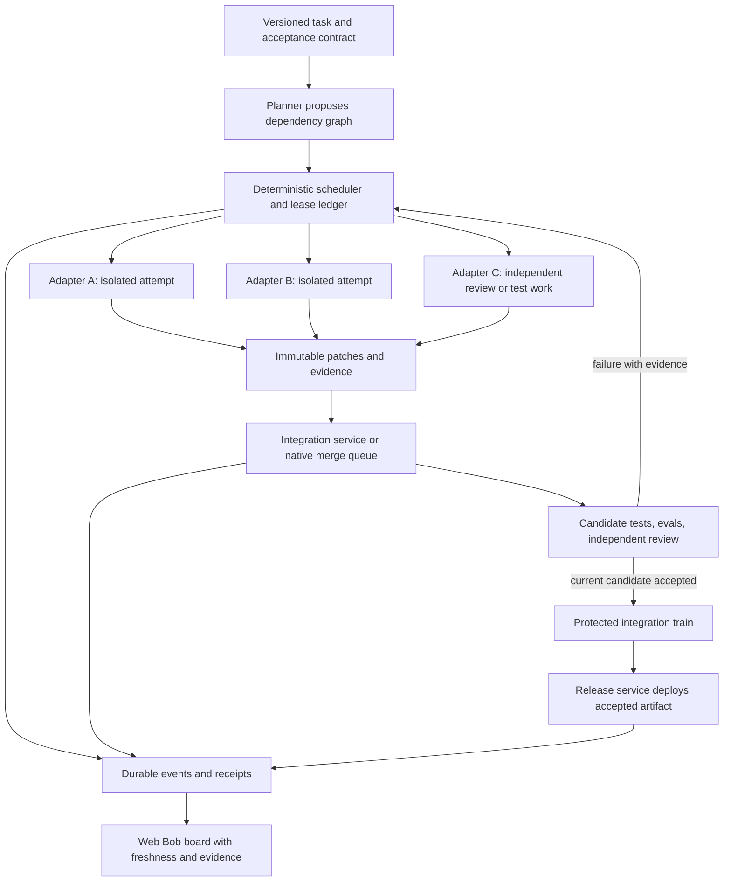

# Multiple LLMs on one codebase: research and architecture review

## Executive summary — 10 lines

1. Heterogeneous parallel coding already exists: Cursor documents cross-model best-of-N, and GitHub Agent HQ brings Copilot, Claude, and Codex into one workflow. [Cursor](https://cursor.com/docs/configuration/worktrees), [GitHub](https://docs.github.com/en/copilot/concepts/agents/about-third-party-coding-agents)
2. The useful unit is one repository with isolated attempts; shared conversations, shared files, isolated worktrees, and isolated runtimes provide different guarantees. [Git worktrees](https://git-scm.com/docs/git-worktree), [container-use](https://github.com/dagger/container-use)
3. Augment Intent, Factory Missions, Cursor Projects, and Devin already overlap substantially with the proposed planner–worker–verifier design. [Intent](https://www.augmentcode.com/blog/intent-a-workspace-for-agent-orchestration), [Missions](https://docs.factory.ai/missions/overview), [Projects](https://cursor.com/docs/agent/projects), [Devin](https://docs.devin.ai/work-with-devin/advanced-capabilities)
4. The proposal's plausible differentiation is an enforceable, vendor-neutral integration and evidence policy for these projects; its individual orchestration primitives are largely prior art.
5. Best-of-N, complementary implementation, model councils, and architect/editor pipelines solve different problems; measure the selected, integrated result, not how many agents ran. [CodeMonkeys](https://arxiv.org/abs/2501.14723), [Aider](https://aider.chat/docs/usage/modes.html)
6. Reuse merge-queue semantics: test the candidate against the current train and earlier changes, then advance only the candidate whose evidence is still valid. [GitHub merge queues](https://docs.github.com/en/repositories/configuring-branches-and-merges-in-your-repository/configuring-pull-request-merges/managing-a-merge-queue), [GitLab merge trains](https://docs.gitlab.com/ci/pipelines/merge_trains/)
7. Different-vendor review is a useful policy, but it is not proof of independent reasoning or correctness; retain deterministic checks and calibrate reviewers. [Contextual-bias study](https://arxiv.org/abs/2603.18740), [merge-resolution study](https://arxiv.org/abs/2607.27674)
8. Route complete task attempts using measured outcomes, tool compatibility, cost, and risk; generic request routers do not schedule repository dependencies or merge code. [RouteLLM](https://github.com/lm-sys/RouteLLM), [Not Diamond](https://docs.notdiamond.ai/docs/routing-between-custom-models)
9. Lifecycle matters: Vibe Kanban's publisher announced shutdown, AutoGen entered maintenance, and SWE-agent recommends mini-SWE-agent for new use. [Vibe Kanban](https://www.vibekanban.com/blog/shutdown), [AutoGen](https://github.com/microsoft/autogen), [SWE-agent](https://github.com/SWE-agent/SWE-agent)
10. Build isolation, transactional leases, and exact-candidate integration first; then evaluate a small heterogeneous swarm against equally budgeted single-agent and homogeneous baselines.

**Research date:** September 27, 2026. **Architecture reviewed:** [MULTI-LLM-SWARM-ARCH-0927.md](../docs/MULTI-LLM-SWARM-ARCH-0927.md), the 18-line v1 proposal. **Deliverable:** research and proposed design changes only; no implementation changes.

## 1. Scope, evidence, and terminology

This report asks a narrower question than “can several AI agents collaborate?” It asks whether different models or coding-agent products can work concurrently on one evolving repository, preserve each other's intended behavior, and produce an integrated revision that can be trusted enough to release.

Product capability statements below come from current official documentation, publisher announcements, or project repositories retrieved for this review. Research findings come from the authors' papers or benchmark repositories. A documented capability is evidence that the publisher describes or exposes it; it is not a claim that I exercised a paid account, reproduced the benchmark, inspected the vendor's private implementation, or proved its reliability. Strengths, gaps, rankings, and proposed changes are explicitly engineering assessments.

“Not established” means that the reviewed public sources did not establish the capability. It does not mean the product cannot implement it privately or through additional configuration. Public previews, experimental features, maintenance transitions, and important documentation ambiguities are called out. Live documentation and GitHub main branches are mutable; this is a dated snapshot, not a promise about future behavior.

Three identities must be kept separate:

- **Model:** the actual inference model and version.
- **Harness:** the software controlling context, tools, retries, permissions, and agent execution—for example, Cursor, Claude Code, Codex, or OpenHands.
- **Provider:** the service serving that model, which may differ from the model's creator.

A “Cursor agent” and a “Claude Code agent” could use related models. Two endpoints could serve the same model. Conversely, one harness can call several models. Consequently, product names alone cannot enforce the proposal's different-vendor review requirement.

### 1.1 Seven distinct forms of orchestration

| Pattern | Work being parallelized or delegated | What has to be combined | Relevance to this proposal |
|---|---|---|---|
| Answer council | Several responses to the same question | Arguments and evidence | Useful for planning and critique; no inherent Git integration |
| Best-of-N | Several alternative implementations of one task | Select one candidate, sometimes synthesize a new one | Useful on uncertain or difficult tasks |
| Complementary workers | Different tasks contributing to one release | All accepted patches and their interactions | The proposal's principal workload |
| Architect/editor | Reason about a change, then translate it into edits | Sequential intermediate representation | Useful specialization; not concurrent task execution |
| Model router | Choose an inference endpoint or model | Usually one response | Cost, latency, availability, and capability selection |
| Agent workflow runtime | Manage messages, state, tools, and execution | Structured results and workflow state | A possible control-plane component |
| Integration queue | Order and validate repository changes | A tested cumulative revision | Required regardless of which coding agents produce patches |

These distinctions follow the actual product interfaces: Perplexity synthesizes model responses; Aider passes an architect's proposal to an editor; Cursor's best-of-N leaves candidate selection to the operator; and GitLab's train validates cumulative changes. They should not be collapsed into a single “multi-agent support” checkbox. [Perplexity Council](https://www.perplexity.ai/help-center/en/articles/13641704-what-is-model-council), [Aider modes](https://aider.chat/docs/usage/modes.html), [Cursor worktrees](https://cursor.com/docs/configuration/worktrees), [GitLab train semantics](https://docs.gitlab.com/ci/pipelines/merge_trains/)

### 1.2 “Same codebase” does not require the same writable directory

Git worktrees give a repository additional working trees with their own checkout state, while sharing parts of the repository's Git administration and refs. They are not virtual machines. Git's worktree lock protects worktree administration; it is not a file-ownership lease for coding agents. [Git worktree manual](https://git-scm.com/docs/git-worktree)

**Engineering implication:** use separate workspaces for simultaneous writers. Also isolate—or deliberately allocate—ports, databases, generated files, caches with mutable contents, browser sessions, and background services. Two worktrees can avoid a source-file overwrite while still corrupting the same test database. A model's separate context window does not create either kind of isolation.

## 2. Capability map

The table is a navigation aid. Detailed evidence and qualifications appear in the named profiles below. “Application-owned” means the team using the framework must supply the repository policy; “operator-led” means the documented workflow relies on a person selecting, reviewing, or integrating results.

| System | Main orchestration pattern | Heterogeneous model/agent support | Repository integration boundary |
|---|---|---|---|
| Perplexity Model Council | Parallel answers plus synthesis | Multiple model families | Answer artifacts, not a documented merge train |
| Comet / Perplexity Computer | Browser and general task orchestration | Computer markets multi-model orchestration | Repository coordination contract not established |
| Cursor | Worktrees, cloud workers, best-of-N, Projects | Explicit cross-model best-of-N | Candidate selection and project review; queue policy separate |
| Codex | Cloud attempts, worktree chats, subagents | Configurable Codex models/roles | App/CLI integration; cross-vendor policy external |
| Claude Code | Subagents and experimental agent teams | Per-agent Claude model configuration | Worktree isolation optional; same-file conflicts remain |
| Jules | Concurrent cloud tasks and parallel attempts | Google-managed agent stack | Branch/session/PR workflow |
| Gemini CLI | Sessions, subagents, remote A2A agents | Gemini configuration plus remote-agent interoperability | Worktree feature experimental; integration external |
| Copilot / Agent HQ | Asynchronous PR agents and agent selection | Copilot, Claude, Codex in current partner docs | GitHub PR checks and merge policy |
| Devin | Coordinator plus managed Devins | External model federation not established | Coordinator can resolve conflicts and combine work |
| Factory | Droids, background tasks, Missions | Per-role models and BYOK surfaces | Worktree/headless primitives; final policy configurable |
| Amp | Subagents, threads, runners, Orbs | Modes, custom configuration, provider routing | Workspace/thread shipping; global train not established |
| Augment | Intent orchestration; Cosmos workers | BYOA in Intent; model-configured subagents | Spec/review workflow and environment distinctions |
| OpenHands | SDK conversations, tools, runtime | Provider-configured LLMs and routing | Application-owned |
| SWE-agent | Issue-solving and batch experimentation | Configurable model providers | Per-issue patches; not a release coordinator |
| Aider | Architect/editor pipeline | Independently selected models | Sequential edits in a working repository |
| Claude Squad | Parallel terminal agent sessions | Several coding harnesses | Worktrees and operator review |
| Conductor.build | Parallel workspaces and sessions | Multiple supported harnesses | Workspace Git/review workflow |
| Vibe Kanban | Task board and isolated attempts | Multiple coding harnesses | Local review/rebase; publisher sunset caveat |
| container-use | Agent execution environments | Harness/model agnostic | Containers plus branches; integration policy external |
| MetaGPT | Software-company roles and SOPs | Configurable LLM backends | Artifact coordination; train not established |
| ChatDev | Visual agent workflows; classic company simulation | Configured workflow/model tooling | Application-owned repository discipline |
| AutoGen / AG2 | Agent runtimes and messaging | Multi-provider configuration | Application-owned; distinct project lifecycles |
| CrewAI | Crews, tasks, Flows | Per-agent LLM configuration | Application-owned |
| LangGraph | State graphs, fan-out, persistence | Model calls supplied by application | Application-owned |
| OpenAI Agents SDK | Tools, handoffs, runs, sandboxes | Per-agent models and provider adapters | Application-owned |
| Mixture-of-agents | Layered answer aggregation | Heterogeneous or homogeneous ensembles | No intrinsic patch integration |
| RouteLLM / Not Diamond / Martian / OpenRouter | Routing and/or inference gateways | Different endpoint/model catalogs | No intrinsic repository scheduler |
| GitHub / GitLab merge queues | Ordered integration with cumulative CI | Model independent | Native integration layer |

## 3. Coding products and operator workbenches

### 3.1 Perplexity Model Council

**What exists.** The current help article describes independent model research followed by synthesis, including agreements and disagreements. Standalone Council uses three selected models and is offered to Max and Enterprise Max users. The Council skill inside Computer has different access and consumption rules: it can use two to eight models and produces individual reports alongside the synthesis. These are separate surfaces, so a plan statement about one should not be generalized to the other. [Current Model Council help](https://www.perplexity.ai/help-center/en/articles/13641704-what-is-model-council)

**Parallel work, routing, and merging.** This is genuine heterogeneous answer fan-out. The documented shared result is a research answer, not a branch, a cumulative test run, or a conflict-resolution transaction.

**Assessment.** Its best transferable idea is preserving individual evidence and minority findings instead of flattening everything into consensus. Use that for architecture review, hypothesis generation, or investigating a failure. Do not count three agreeing prose answers as three independently validated implementations. The missing evidence for this project is a public repository-control contract covering write ownership, candidate SHAs, and merge eligibility.

### 3.2 Comet, Computer, and Personal Computer

**What exists.** Comet's publisher documented background assistants that handle multiple tasks in parallel and centralize progress and confirmation handling. This is browser-oriented delegation. [Comet background-assistant announcement](https://www.perplexity.ai/en-GB/changelog/what-we-shipped-october-3rd)

Perplexity's current Personal Computer page adds Mac app control, local-file access, and Comet-assisted browser automation. Its Computer materials position the product as a broader multi-model worker, so describing all of Perplexity as “only a search chatbot” would be inaccurate. [Personal Computer](https://www.perplexity.ai/personal-computer), [Computer launch changelog](https://www.perplexity.ai/changelog/what-we-shipped---february-27-2026)

**Assessment.** This could supervise research, browser verification, or operational tasks around development. The reviewed material does not establish a same-repository scheduler with enforced file leases or a merge train. Local file access is not evidence of either. Do not import historical model counts from launch announcements as the current model catalog. For this architecture, treat Perplexity as an optional research or verification adapter until its task lifecycle and repository semantics are demonstrated.

### 3.3 Cursor: cross-model best-of-N, cloud agents, and Projects

**What exists.** Cursor explicitly documents `/best-of-n` with a comma-separated list of models. Each attempt receives its own worktree. The workflow compares the attempts and does **not** automatically merge them; the operator chooses a result to commit, push, or apply. The same documentation distinguishes the Agents Window's worktree workflow from the IDE's skill-based commands. [Cursor worktrees and best-of-N](https://cursor.com/docs/configuration/worktrees)

Cloud Agents execute in isolated VMs, can use development tools and browsers, and return artifacts such as logs and visual evidence. That provides a stronger execution boundary than merely running several chats in one checkout. [Cursor Cloud Agents](https://cursor.com/docs/cloud-agent)

Projects adds a coordinator that plans and delegates coding work rather than writing code itself. The current documentation says Projects is rolling out and excludes Enterprise plans and Privacy Mode (Legacy); it exposes a coordinator-model choice. Do not infer unrestricted per-worker automatic routing from that setting. [Cursor Projects](https://cursor.com/docs/agent/projects)

**Assessment.** Cursor is a direct comparator for both the proposal's worker pool and its planner. It already disproves a broad novelty claim for “different models implementing the same task in parallel.” Steal explicit attempt identity, reproducible worktree setup, and reviewable execution artifacts. The remaining architectural question is whether the chosen surface gives this conductor enough API control and provenance to enforce its own leases, budget, different-vendor reviews, and integration queue. Also, “local, plentiful” in v1 is a resource assumption, not a verified entitlement or cost model.

### 3.4 Codex: best-of-N cloud attempts, worktrees, and subagents

**What exists.** The current command reference documents `codex cloud exec --attempts` with one to four attempts. This is a real interface for multiple attempts at a cloud task. The flag by itself does not establish cross-vendor generation or an automatic correctness oracle. [Codex command reference](https://learn.chatgpt.com/docs/developer-commands)

Codex-managed worktrees let separate chats work on the same project in separate checkouts. The app supports creating a branch/PR from a worktree or handing work back to the local checkout; those are distinct from a project-wide merge queue. Current subagent documentation also describes parallel delegation, configurable models and reasoning settings for custom agents, and parent-controlled follow-up and collection. It warns that write-heavy parallel work creates coordination costs. [Codex worktrees](https://learn.chatgpt.com/docs/environments/git-worktrees), [Codex subagents](https://learn.chatgpt.com/docs/agent-configuration/subagents)

**Parallel work and merging.** Treat cloud attempts, worktree chats, and subagents as different execution modes. A delegated agent is not automatically evidence of an independent filesystem. The documented attempt count is also not a selected-result success rate.

**Assessment.** Codex is a plausible implementation worker, reviewer, or resolver behind an adapter. The proposal should record exact model configuration, workspace identity, and attempt results rather than use “Codex” as a complete provenance record. Best-of-N belongs on tasks where alternative approaches have measurable value; routine complementary tasks should not automatically incur several competing full implementations. The Agents SDK discussed later is a separate integration choice, not another name for Codex cloud.

### 3.5 Claude Code: subagents and agent teams

**What exists.** Subagents have their own context, instructions, tools, and optional model configuration. Worktree isolation can be requested explicitly; separate context alone does not imply it. [Claude Code subagents](https://code.claude.com/docs/en/sub-agents)

Agent teams give a lead multiple independently contextualized teammates, direct communication, and shared task coordination. The current documentation still labels teams experimental and disabled by default, enabled through `CLAUDE_CODE_EXPERIMENTAL_AGENT_TEAMS`. It explicitly warns that teammates editing the same file can overwrite one another and recommends dividing work accordingly. Current documentation also permits messaging in some named-subagent configurations, so the older simplification “subagents can never communicate” is no longer a reliable distinction. [Claude Code agent teams](https://code.claude.com/docs/en/agent-teams)

**Routing and integration.** Model selection within the documented Claude environment is useful specialization. It is not evidence of a built-in arbitrary-vendor pool. Shared task coordination does not amount to an enforced file lease, and a team conversation does not substitute for a tested cumulative branch.

**Assessment.** Steal task decomposition, direct clarification between dependent workers, and explicit isolation controls. Keep the conductor responsible for workspace creation and patch acceptance. A team is particularly useful for bounded investigation or complementary implementation with clear ownership; it is less attractive when most work depends on a single evolving design decision. Resolver edits still require a fresh independent review, even if the resolver belongs to the same team.

### 3.6 Jules

**What exists.** Jules supports multiple simultaneous tasks, with an independent VM for each task. Its CLI documents `remote new --parallel <number>` for parallel sessions and commands for inspecting and pulling results. [Jules tasks and repositories](https://jules.google/docs/tasks-repos), [Jules CLI reference](https://jules.google/docs/cli/reference)

**Parallel work, merging, routing.** This covers isolated task execution and competitive attempts through a Google-managed coding agent. A completed session can contribute code to a repository workflow; the reviewed interfaces do not establish a heterogeneous model scheduler or a cumulative, cross-task merge train. Separate VMs prevent workspace interference during execution but do not make their patches semantically compatible.

**Assessment.** Jules is relevant as another asynchronous worker behind the conductor. Its value is the managed execution environment and task lifecycle. The adapter should import a specific completed session, preserve logs and its source revision, and pass the patch through the same train as local workers. Avoid scheduling an issue independently in Jules and another product unless it is explicitly a best-of-N experiment; otherwise the system can mistake duplicate solutions for complementary work.

### 3.7 Gemini CLI

**What exists.** Gemini CLI documents native worktree sessions through `--worktree` / `-w`, currently behind an experimental configuration flag. Each session has a separate checkout and branch; setup and cleanup remain operational concerns. [Gemini CLI worktrees](https://geminicli.com/docs/cli/git-worktrees/)

Local subagents support their own instructions, tools, and model setting. Remote subagents use A2A, and the documentation states that the CLI can connect to compliant A2A agents. This provides a route to heterogeneous external specialists without claiming that every remote agent shares the same repository semantics. [Local subagents](https://geminicli.com/docs/core/subagents/), [Remote A2A subagents](https://geminicli.com/docs/core/remote-agents/)

The model-routing page primarily describes availability fallback, including policies that can prompt before switching; it also documents experimental local routing. This is different from selecting the best coding harness for a repository task. [Gemini model routing](https://geminicli.com/docs/cli/model-routing/)

**Assessment.** Gemini CLI is useful as a configurable worker and for an A2A adapter experiment. The conductor still needs to pin the revision, enforce task scope, and import results. “Whole-repo audit” should be a measured workload with retrieval and test evidence, not an assumption that a large context window ensures comprehensive understanding. Persist the effective model after fallbacks; the requested model alone is insufficient.

### 3.8 GitHub Copilot coding/cloud agent and Agent HQ

**What exists.** GitHub's current cloud-agent documentation describes an asynchronous coding agent working in its own ephemeral GitHub Actions development environment, able to inspect code, change it, and run checks. The product is called “cloud agent” in the current documentation; older material commonly says “coding agent.” [Copilot cloud agent](https://docs.github.com/en/copilot/concepts/agents/cloud-agent/about-cloud-agent)

Agent HQ's current third-party documentation lists Anthropic Claude and OpenAI Codex, with public-preview status. It provides model selection within each partner agent and notes that the partner “Auto” choice is distinct from Copilot's own automatic selection. Current billing is described in AI credits and Actions minutes, so launch-era descriptions should not be used as present-day cost assumptions. [Current third-party agent documentation](https://docs.github.com/en/copilot/concepts/agents/about-third-party-coding-agents)

GitHub's Agent HQ announcement explicitly illustrates assigning the same issue to different agents and comparing their approaches. That is competitive execution inside a common repository workflow, not proof that the agents automatically coauthor one branch. [Agent HQ announcement](https://github.blog/news-insights/company-news/pick-your-agent-use-claude-and-codex-on-agent-hq/)

**Assessment.** This is one of the strongest existing choices when GitHub PRs are the operational boundary. Steal centralized session visibility and native review/check integration. Preserve the distinction between selecting an agent and selecting its underlying model. If native queues are available for the repository, use them for integration rather than inventing a weaker branch-updating loop. Do not turn the wider partner list from an announcement into a claim that every promised integration is currently available.

### 3.9 Devin

**What exists.** Current advanced-capabilities documentation describes a coordinating Devin launching managed Devins in separate VMs, scoping and monitoring their tasks, communicating with them, resolving conflicts, and compiling results. It also documents controls and reusable workflows around this orchestration. This is substantially more than a collection of independent chat tabs. [Devin advanced capabilities](https://docs.devin.ai/work-with-devin/advanced-capabilities)

Devin also publishes a workflow example in which several agents try different solutions and a coordinator evaluates the results. That is a useful design example; its illustrative outcomes are not independent performance evidence. [Devin multi-attempt example](https://docs.devin.ai/use-cases/gallery/batch-3-agents-best-solution)

**Routing and gaps.** The reviewed sources establish managed-agent orchestration but not a general external-vendor model federation contract. They also do not prove that conflict resolution preserves all intended behavior under the conductor's particular eval suite.

**Assessment.** Devin is a direct prior-art comparator for the resolver and coordinator roles. Reuse its explicit child-task scoping and budget controls conceptually. For adoption, require a concrete result interface—base revision, head revision, checks, and artifacts—rather than treating a coordinator's completion message as integration approval. Older plan-specific descriptions of “Advanced Mode” should not override the current capabilities page.

### 3.10 Factory

**What exists.** Factory's custom droids support specialized prompts, model/tool configuration, and background execution. The documentation describes collecting or stopping background tasks and choosing model tiers. Nested spawning is constrained: subagents cannot simply recurse into an unbounded organization. [Factory subagents](https://docs.factory.ai/harness/subagents)

Missions adds a structured planner and execution workflow with features, milestones, worker coordination, and validation. Its documentation explicitly says reliable user-facing QA requires a scriptable way to exercise the application and dependencies. [Factory Missions](https://docs.factory.ai/missions/overview)

The headless interface exposes worktrees and structured session control, plus separate mission worker and validator model flags. BYOK is a separate capability with surface-specific support; the documentation distinguishes CLI/desktop use from hosted surfaces. [Droid Exec](https://docs.factory.ai/droid-exec/overview), [Factory BYOK](https://docs.factory.ai/model-independence/byok)

**Assessment.** This is one of the closest documented matches to the proposed division between planner, workers, and validators, and one of the more concrete adapter candidates because the headless interface exposes those distinctions. Steal explicit worker/validator configuration and readiness checks. The existence of Missions does not establish the exact cross-vendor gate, path-fencing semantics, or integration invariants required here. Verify those at the adapter boundary. Treat scriptable application testing as a prerequisite to scale, not a task deferred until after several agents have already produced code.

### 3.11 Amp

**What exists.** Current Amp documentation describes configurable modes and specialist subagents with separate contexts. Its ordinary subagents return results to the parent and have communication/steering limitations; that surface should not be confused with a fully conversational agent team. [Amp models and subagents](https://ampcode.com/docs/models-and-subagents)

Amp also has Orbs: remote agent environments that can run independent tasks, execute applications, and preserve reviewable files and evidence. Runners support worktree creation for threads and safe cleanup behavior. Ignoring those surfaces would understate its current parallel-development capabilities. [Amp Orbs](https://ampcode.com/docs/orbs), [Amp runners](https://ampcode.com/docs/cli/runners)

Its provider-routing documentation distinguishes changing the endpoint that serves a selected model from changing the model itself. Custom gateways are documented with availability qualifications. [Amp model routing](https://ampcode.com/docs/customize/model-routing)

**Assessment.** Steal thread-level workspace identity and the combination of code, running services, and proof in one reviewable unit. Amp can be a serious execution surface; a comparison based only on its early single-thread product would be stale. The reviewed pages do not establish a project-wide file-lease scheduler or conductor-style train. Track both the chosen mode/model and the actual serving provider, and do not label provider remapping as a quality router.

### 3.12 Augment: Intent and current Cosmos worker semantics

**What exists.** Augment's Intent materials describe a living specification, a coordinator, implementation waves, a verifier, isolated workspaces, and Git review. The announcement explicitly supports bringing Claude Code, Codex, or OpenCode alongside Augment's own agent. This is direct prior art for several v1 concepts. [Intent announcement](https://www.augmentcode.com/blog/intent-a-workspace-for-agent-orchestration)

The walkthrough, updated September 17, 2026, describes developer checkpoints and parallel implementation worktrees. Its claims should be read alongside the more precise current runtime documentation rather than generalized to all Augment agents. [Intent walkthrough](https://www.augmentcode.com/guides/intent-walkthrough-prompt-to-merge)

Current Cosmos documentation draws a useful distinction: a **worker** is a full Expert with a separate environment, whereas a **subagent** has a separate context/model but no separate environment. That distinction directly affects safe concurrent writing. [Cosmos workers and subagents](https://docs.augmentcode.com/cosmos/workers-subagents)

**Assessment.** Augment is among the closest product comparators. Steal the shared specification and explicit verifier, but version the spec so an in-flight task cannot silently inherit a changed contract. Verify isolation at the worker type actually launched. The coexistence of Intent publications and Cosmos-oriented documentation is not sufficient evidence that Intent has been discontinued, nor that every capability is interchangeable between them. A purchase or integration decision should test the exact surface and account being considered.

### 3.13 OpenHands

**What exists.** The current Software Agent SDK supports configurable LLMs, conversation execution, and isolated Docker workspaces. Its routing guide exposes a router abstraction and a concrete multimodal routing example; that is a usable extension point, not a universal learned coding-task router. [OpenHands Docker workspace](https://docs.openhands.dev/sdk/guides/agent-server/docker-sandbox), [OpenHands model routing](https://docs.openhands.dev/sdk/guides/llm-routing)

The concurrency distinction is unusually explicit: TaskToolSet subagents run synchronously and block the parent, while the separate async guide demonstrates running multiple conversations concurrently. A “subagent” feature therefore does not by itself establish parallel execution. [TaskToolSet](https://docs.openhands.dev/sdk/guides/task-tool-set), [Concurrent conversations](https://docs.openhands.dev/sdk/guides/convo-async)

**Assessment.** OpenHands is a useful foundation if the conductor should own a model-neutral coding runtime rather than wrap only proprietary CLIs. It offers execution building blocks and control over the application, but the application still needs task leases, dependencies, result validation, and merge policy. The adoption question is operational: whether maintaining this runtime is cheaper and more reliable than adapting existing harnesses. Do not compare old OpenHands documentation with current vendor products without identifying the version.

### 3.14 SWE-agent

**What exists.** SWE-agent is a configurable issue-solving system and experimentation harness. Its batch workflow and trajectory artifacts are relevant to measuring independent repair attempts; they do not establish coordinated integration of unrelated tasks into one evolving release. Its model configuration uses provider abstractions, allowing experiments with different models. [SWE-agent usage](https://github.com/SWE-agent/SWE-agent/blob/main/docs/usage/hello_world.md), [Provider configuration](https://github.com/SWE-agent/SWE-agent/blob/main/docs/installation/keys.md), [Trajectory artifacts](https://github.com/SWE-agent/SWE-agent/blob/main/docs/usage/trajectories.md)

The current repository says most development effort has moved to mini-SWE-agent and recommends that project for new use. This is a relevant maintenance signal, not proof that existing SWE-agent deployments have stopped working. [Current SWE-agent README](https://github.com/SWE-agent/SWE-agent)

**Assessment.** Reuse the reproducible attempt/trajectory mindset and consider the current successor for the evaluation harness. Avoid adopting an issue-benchmark runner as if it were a long-lived multi-project supervisor. Its natural output is a candidate repair; the conductor must decide whether and how that repair joins the train.

### 3.15 Aider architect/editor

**What exists.** Architect mode first asks the main model to propose a solution, then asks an editor model to turn that proposal into file edits. The editor is independently configurable. This is a concrete two-model specialization pipeline, generally sequential. [Aider chat modes](https://aider.chat/docs/usage/modes.html)

**Parallel work and merging.** Multiple externally launched Aider sessions can be isolated by another tool, but architect mode itself does not supply a complementary-worker scheduler, file leases, or a merge train.

**Assessment.** Steal the separation between reasoning about a change and applying it, particularly if a strong planner and a cheaper editor prove effective on local tasks. Account for both model calls and their failure modes. An editor following an architect's incorrect plan is correlated execution, not independent review. The architect should emit a bounded, testable change contract; a separate reviewer and the integration checks should assess the resulting code.

### 3.16 Claude Squad

**What exists.** Claude Squad is a terminal supervisor using separate sessions and Git worktrees for coding agents. Its README documents agent configuration and reviewing, committing, or checking out changes. Despite the name, it can manage multiple coding harnesses rather than only Claude. [Claude Squad repository](https://github.com/smtg-ai/claude-squad)

**Parallel work, routing, merging.** It is a practical heterogeneous session launcher and operator workbench. Choosing a configured program is not automatic task-quality routing. Worktree separation avoids immediate checkout interference; review and integration remain deliberate actions.

**Assessment.** This is a useful lightweight baseline: before building a large supervisor, compare the user experience against a worktree/session manager with clear diffs. Steal visible session ownership and easy recovery of work. The gap relative to v1 is automated dependency-aware scheduling and enforceable merge evidence, not the ability to open several agents.

### 3.17 Conductor.build

**What exists.** Conductor.build's parallel-agent documentation distinguishes independent workspaces, with their own branch/worktree and runtime workflow, from multiple agents inside one workspace. In the latter mode, agents intentionally share files and can edit the same files. This is an important qualification to any broad “isolated parallel agents” claim. [Conductor parallel-agent concepts](https://www.conductor.build/docs/concepts/parallel-agents)

Its guides describe running multiple Claude Code and Codex sessions. The product is an operator-facing workbench around coding agents and Git workflows, not merely another model endpoint. [Claude Code sessions](https://www.conductor.build/docs/guides/parallel-agents/run-multiple-claude-code-sessions), [Codex sessions](https://www.conductor.build/docs/guides/parallel-agents/run-multiple-codex-sessions)

**Assessment.** This is an especially relevant comparator for workspace creation, session visibility, review, and handoff. Separate its product name from this repository's local `conductor` project: they are not evidence of the same implementation. Steal clear workspace boundaries. For automated use, verify a supported machine interface rather than assume every desktop action has a stable API. Its shared-workspace mode should be explicitly disallowed for simultaneous uncoordinated writers in the proposed pilot.

### 3.18 Vibe Kanban

**What exists.** Vibe Kanban's repository documents local workspaces, multiple supported coding agents, task/diff workflows, and execution tooling. Its conflict guide provides both manual resolution and an agent-assisted rebase flow: the application supplies context to the agent and continues the rebase after resolution. [Vibe Kanban repository](https://github.com/BloopAI/vibe-kanban), [Rebase-conflict workflow](https://www.vibekanban.com/docs/core-features/resolving-rebase-conflicts)

**Current availability caveat.** On April 10, 2026, its publisher announced the company was shutting down, planned to wind down remote services after 30 days, and said local workspaces would continue working with community-led open-source development. That announcement is stronger evidence about lifecycle than an older feature page. I have not tested whether any particular hosted account still works. [Publisher shutdown announcement](https://www.vibekanban.com/blog/shutdown)

**Assessment.** Steal the task-attempt board, conflict visibility, and explicit rebase-recovery UX. Treat the local open-source application as a candidate to inspect or reuse, with maintenance due diligence. Do not recommend the historical hosted offering as an assured long-term dependency. Automated marker resolution still needs behavior-preservation tests before acceptance.

### 3.19 container-use

**What exists.** Dagger's container-use supplies agent development environments, with a fresh container and Git branch for each environment, logs, inspection, and Git-oriented integration. It is designed to work with coding-agent tools rather than prescribe one model. [container-use repository](https://github.com/dagger/container-use), [Dagger's technical introduction](https://dagger.io/blog/agent-container-use/)

**Parallel work and merging.** This is execution isolation infrastructure. It separates more than source checkouts, but the surrounding application still chooses tasks, models, permissions, and merge criteria. A merge command is not a merge queue with evidence invalidation.

**Assessment.** This is one of the most useful components to prototype against v1's missing runtime boundary. Test reproducibility, startup overhead, artifact export, and how services or storage outside the container are scoped. An environment abstraction should also work for a local CLI today and a remote worker later, without changing the task's acceptance contract.

## 4. General orchestration frameworks

These frameworks are relevant because the proposed conductor needs persistent state, controlled fan-out, and model adapters. They are not interchangeable with coding products: an agent framework can coordinate tool calls successfully while leaving all repository concurrency rules to its caller.

### 4.1 MetaGPT

**What exists.** MetaGPT organizes software work into roles such as product manager, architect, project manager, and engineer, with standard operating procedures and intermediate artifacts. Its repository documents configurable LLM backends. This is clear prior art for role specialization and artifact-driven collaboration. [MetaGPT repository](https://github.com/FoundationAgents/MetaGPT)

**Parallelism, routing, and integration.** A collection of roles does not establish that each role writes concurrently or that each has a separate branch. Provider configuration enables model choice; it does not, by itself, establish outcome-trained routing. The reviewed materials do not establish v1-style enforceable path leases and a cumulative merge train.

**Assessment.** Steal typed intermediate deliverables: requirements, interface definitions, implementation plans, and review results. Avoid copying organizational role names without concrete input/output contracts. For an existing codebase, the difficult work is preserving existing behavior and coordinating evolving dependencies; a simulated software company is not sufficient evidence that those problems are solved.

### 4.2 ChatDev

**What exists today.** The current repository is ChatDev 2.0, also called DevAll, introduced in January 2026 as a configurable multi-agent workflow platform with visual/graph and SDK surfaces. The classic software-company version remains separately identified as ChatDev 1.0. Treating the old CEO/CTO/programmer demonstration as the entire current project would miss that transition. [ChatDev repository](https://github.com/OpenBMB/ChatDev)

**Parallelism, routing, and integration.** Configurable workflows can express agent collaboration, but the reviewed README alone does not prove that every graph executes independent nodes concurrently. Likewise, model/provider configuration should not be inflated into a measured adaptive routing capability. A Git integration contract comparable to v1's leases and train was not established.

**Assessment.** The transferable idea is that the orchestration graph is an explicit artifact that can be inspected and revised. A generic graph editor is less valuable here than a small set of reliable transitions with clear acceptance rules. If evaluated further, verify concurrency, cancellation, restart recovery, and branch export in the actual current version.

### 4.3 Microsoft AutoGen and its successor

**What exists.** AutoGen's architecture includes event/message-oriented infrastructure, higher-level agent interaction patterns, and extension/model integrations. Some higher-level conversations are intentionally turn-based; “multi-agent” is not synonymous with simultaneous execution. [AutoGen documentation](https://microsoft.github.io/autogen/stable/index.html)

The current repository states that AutoGen is in maintenance mode, will receive no new features, and directs new projects toward Microsoft Agent Framework. It describes Agent Framework 1.0 as its production successor with multi-provider and interoperability support. This is the project's own lifecycle statement, not a comparative reliability benchmark. [AutoGen repository and migration direction](https://github.com/microsoft/autogen)

**Assessment.** Existing AutoGen installations can be useful, but it is a weak default for a new long-lived conductor without an explicit maintenance rationale. Evaluate the successor separately before adopting it; the migration recommendation does not establish its Git conflict behavior. Reuse event-driven supervision concepts while keeping branch mutation under a narrow integration service.

### 4.4 AG2

**What exists.** AG2 is a distinct project, not a synonym for Microsoft's current AutoGen release. Its current documentation describes an async-first agent API, configurable providers, opt-in harness components, persistent streams, and parallel subtask fan-out. [AG2 current architecture](https://docs.ag2.ai/docs/user-guide/motivation/)

Its network layer adds a central registry, capability information, durable channel transcripts, governance, and cross-process transports. That is directly relevant to the proposal's honest board and worker identity. However, a channel transcript or process boundary is not a repository snapshot or filesystem lease. [AG2 multi-agent network](https://docs.ag2.ai/docs/user-guide/network/overview/)

**Assessment.** Steal explicit identities, causal event records, and separation between observed capability and an agent's claimed capability. Verify the particular execution pattern: the existence of async infrastructure does not make every higher-level recipe parallel. As with other frameworks, the caller must supply workspaces, submission rules, and integration checks. Pin a version and validate recovery behavior before relying on rapidly changing APIs.

### 4.5 CrewAI

**What exists.** CrewAI has per-agent LLM/tool configuration, tasks with expected outputs and guardrails, sequential or hierarchical crew processes, and explicitly asynchronous task execution. A hierarchical process describes assignment/control; it should not be assumed to make all work simultaneous. [CrewAI agents](https://docs.crewai.com/en/concepts/agents), [CrewAI tasks](https://docs.crewai.com/en/concepts/tasks)

Flows adds structured state and persistence, including a documented SQLite persistence implementation and resume/fork behavior. These are useful workflow primitives. They do not make arbitrary external effects—such as Git pushes—transactional with the saved flow state. [CrewAI Flows](https://docs.crewai.com/en/concepts/flows)

**Assessment.** CrewAI can implement a planner–worker–reviewer workflow and model specialization. Its main gap for this task is repository policy: worker filesystem boundaries, file-scope enforcement, exact candidate validation, and retry reconciliation still have to be built. A task marked complete by the crew should mean “candidate submitted” until the separate integration layer accepts it.

### 4.6 LangGraph

**What exists.** LangGraph documents parallel branches, routing, and orchestrator–worker workflows, including dynamically created work. Models and tools are supplied by the application, so a graph can coordinate different model providers or different harness adapters. [LangGraph workflows and agents](https://docs.langchain.com/oss/python/langgraph/workflows-agents)

Persistence distinguishes thread checkpoints from cross-thread storage. Current documentation explicitly warns that in-memory checkpointers do not survive process restarts. Persisting graph state and persisting external repository effects are separate responsibilities. [LangGraph persistence](https://docs.langchain.com/oss/python/langgraph/persistence)

**Assessment.** This is a strong candidate when the conductor needs an explicit, inspectable state machine with fan-out and recovery. Its state reducers combine workflow data; they do not resolve Git or semantic code conflicts. Keep critical transitions deterministic: a graph node may ask an LLM to propose a task split, but ordinary application logic should validate leases and decide whether evidence authorizes a train advance. The framework is optional; a smaller durable scheduler can implement the same invariants.

### 4.7 OpenAI Agents SDK

**What exists.** The Agents SDK runs the agent loop inside the application's infrastructure. It supports agents as tools, handoffs, tracing/integration surfaces, and explicit per-agent or run-level model selection. Provider/adapter surfaces support non-OpenAI and mixed-provider configurations, with feature-compatibility qualifications. [SDK overview](https://developers.openai.com/api/docs/guides/agents/sdk), [Models and providers](https://developers.openai.com/api/docs/guides/agents/models)

The orchestration guide distinguishes a handoff, which transfers conversational ownership, from a specialist exposed as a tool, which leaves ownership with a manager. Neither term alone guarantees concurrent execution; application orchestration must define fan-out and result collection. [Orchestration and handoffs](https://developers.openai.com/api/docs/guides/agents/orchestration)

Current SDK documentation also includes sandbox agents and explicitly separates the trusted harness/control plane from execution compute. Sandboxes supply files, commands, ports, and resumable workspace capabilities. [Sandbox agents](https://developers.openai.com/api/docs/guides/agents/sandboxes)

**Assessment.** This is another credible control-plane/runtime building block. Steal the separation between orchestration state and code-execution environments. The application still owns the Git scheduler, leases, merge queue, and deployment evidence. Do not conflate the SDK, the managed Agents API, the Responses API, and Codex: they are different boundaries with different operational contracts.

## 5. Mixture-of-agents and model routers

### 5.1 Mixture-of-agents

**What exists.** The original Mixture-of-Agents work aggregates outputs through layers: models in later layers consume earlier outputs. Its reported evaluation concerns response-quality benchmarks such as AlpacaEval, MT-Bench, and FLASK, not concurrent changes to one repository. [Mixture-of-Agents paper](https://arxiv.org/abs/2406.04692)

Follow-up Self-MoA research finds many settings where ensembling the strongest single model outperforms mixing different models. This is evidence against assuming diversity is automatically beneficial, not evidence that heterogeneous coding teams never help. [Rethinking Mixture-of-Agents](https://arxiv.org/abs/2502.00674)

**Parallel work, routing, and merging.** Independent first-layer generation can be parallel; later synthesis introduces dependencies. Model selection and aggregation are part of the design. There is no inherent Git workspace, conflict handling, or behavioral test oracle.

**Assessment.** Use the pattern for comparing plans or finding review hypotheses. For code, preserve candidates separately and evaluate them before selecting or synthesizing. A synthesized patch is a new candidate that requires its own tests. Mixing a weak answer into a stronger one can reduce quality, and exposing all reviewers to the first answer can destroy the independence that justified the council.

### 5.2 RouteLLM

**What exists.** RouteLLM is an open routing framework centered on choosing between stronger and cheaper models using a quality/cost threshold. It supplies routing strategies, provider integration, calibration, and evaluation tooling. Its README emphasizes calibrating on queries resembling the incoming workload. [RouteLLM repository](https://github.com/lm-sys/RouteLLM)

**Parallel work and merging.** Its normal unit is an inference request, not a coding attempt with a branch and test budget. It neither partitions a repository nor resolves conflicts among workers.

**Assessment.** Steal workload-specific calibration and an explicit quality/cost tradeoff. Do not import historical chat-benchmark savings into a 2026 coding budget. A cheap request that triggers repeated failed edits can have higher total accepted-change cost. Start with deterministic task-level routing; consider a learned router after collecting enough labeled outcomes from this codebase.

### 5.3 Not Diamond

**What exists.** Not Diamond documents training routers using prompts, model outputs, and evaluation scores. Custom routing can include arbitrary inference endpoints, including agents, with explicit context, price, and latency metadata. That makes its scope broader than choosing among a fixed list of chat models. [Router training](https://docs.notdiamond.ai/docs/router-training-quickstart), [Custom models and agents](https://docs.notdiamond.ai/docs/routing-between-custom-models)

**Parallel work and merging.** Routing chooses where to send work. It does not provide file leases, a repository dependency graph, or a tested merge train.

**Assessment.** This is conceptually well matched to eventually routing whole worker configurations, provided a worker can be represented with meaningful cost and outcome data. Train on task success after integration, repair cost, and latency—not an uncalibrated model's preference for another model's prose. Use held-out tasks and retain a fallback to a known competent configuration. A trained score cannot override the project's provider exclusions or required tool capabilities.

### 5.4 Martian

**What can be verified today.** Martian's current public documentation prominently exposes a multi-model Gateway and an agent research/evaluation suite. The gateway accepts an explicit model choice. Separate Martian SDK documentation describes trained router resources, quality/latency constraints, and versioned router configuration. These are different surfaces. [Current Martian documentation](https://docs.withmartian.com/), [Martian router SDK documentation](https://withmartian.github.io/martian-sdk-python/api/router.html)

**Availability qualification.** The router reference identifies itself as SDK 0.1 documentation, while current public pages direct some tooling to partner access. The research does not establish unrestricted current access to every historically advertised intelligent-routing product. A functioning documentation URL is not proof that an account can provision the service.

**Assessment.** Steal versioned routing policies and explicit constraints. Treat the current gateway as a provider abstraction and investigate router availability before putting it on the critical path. Neither the gateway nor the inspected router contract establishes concurrent repository coordination. Do not repeat broad historical cost-saving claims as measured results for this project.

### 5.5 OpenRouter

**What exists today.** OpenRouter separates model fallback from provider routing. A fallback list tries another model when an earlier choice errors; the response reports the model actually used. Provider routing chooses among endpoints serving a model. These distinctions matter for reviewer independence and policy enforcement. [Model fallbacks](https://openrouter.ai/docs/guides/routing/model-fallbacks), [Provider routing](https://openrouter.ai/docs/guides/routing/provider-selection)

**Important current-documentation correction.** The live Auto Router page now describes task classification and rankings based on trailing community spend, with cost tiers and restrictions. Older descriptions of `openrouter/auto` as simply a Not Diamond-powered selector do not describe the retrieved current page. It also warns that settings sent under the wrong stable/beta plugin identifier can be ignored. [Current Auto Router](https://openrouter.ai/docs/guides/routing/routers/auto-router)

**Assessment.** OpenRouter is useful for access, provider selection, and availability. Market usage is not a local coding-quality evaluation. Pin allowed model families and verify the effective result; use an explicit allowed set to preserve “Never Grok/xAI,” including fallback paths. It supplies no inherent same-codebase scheduler or merge arbiter. For long coding attempts, uncontrolled model changes can also invalidate assumptions about tool support, context, cost, and reviewer independence.

### 5.6 Routing policy this project actually needs

The recommended routing decision is an application decision over a **worker configuration**, not just a model string:

| Dimension | Example decision |
|---|---|
| Task class | Localization, implementation, test generation, semantic review, conflict repair |
| Required capabilities | Shell, browser, image inspection, structured output, resumable session |
| Risk and blast radius | Isolated module versus authentication, shared schema, or release configuration |
| Available evidence | Strong acceptance tests versus ambiguous product behavior |
| Empirical quality | Accepted result rate and escaped defects on comparable project tasks |
| Total cost | Generation, review, retries, runtime, and integration repair |
| Availability | Rate limits, worker slots, cold-start time, current queue |
| Policy | Allowed vendors, permitted data access, reviewer separation |

This table is a proposed design, not a documented capability of every router above. The initial implementation should be a small ruleset with recorded reasons. A learned router becomes useful only when local evidence can outperform those rules.

## 6. Merge queues: the established integration layer

### 6.1 GitHub

GitHub's merge queue checks a pull request against the latest target branch and earlier queued changes. It uses temporary merge-group revisions rather than relying solely on a worker's original PR checks. For Actions-based required checks, the workflow must handle `merge_group`; ordinary `pull_request` or `push` triggers are not equivalent. Availability is also plan/repository dependent: current documentation lists public organization repositories and private organization repositories on Enterprise Cloud. [GitHub merge-queue documentation](https://docs.github.com/en/repositories/configuring-branches-and-merges-in-your-repository/configuring-pull-request-merges/managing-a-merge-queue)

**Assessment.** This is the preferred integration mechanism when available and compatible with the project's hosting. The conductor should submit candidates and required evidence into native protections. It should not bypass them with a branch-writing bot. GitHub verifies configured checks, not every possible behavior; an incomplete test suite remains incomplete inside a queue.

### 6.2 GitLab

GitLab merge trains validate cumulative candidates: target plus A, target plus A and B, and so on. Those pipelines can run concurrently while integration remains ordered. If an earlier candidate fails, later combinations are rebuilt. Current documentation lists Premium and Ultimate availability. [GitLab merge trains](https://docs.gitlab.com/ci/pipelines/merge_trains/)

**Assessment.** This is the right conceptual upgrade to “rebase every few minutes.” Begin with one candidate in validation if capacity is small. Add speculative cumulative validation only when measurements show the queue, rather than coding or review, is the bottleneck. Speculation can reduce waiting but wastes work when early candidates fail.

### 6.3 What a queue solves—and what it leaves to this design

Native queues supply ordering and combined-revision checks. They do not choose complementary agent tasks, decide whether a plan is correct, enforce different-vendor reasoning, or prove that a generated test suite covers both sides' intentions.

The proposal should separate:

1. **Scheduling:** which task is ready and who may attempt it.
2. **Candidate production:** which immutable patch and evidence a worker submitted.
3. **Integration:** which combination is validated and allowed onto the train.
4. **Release:** which accepted artifact is deployed and how its health is checked.

A worker can succeed at candidate production while its patch remains incompatible with the current train. That should be visible as a distinct state, not reported as either “nothing happened” or “shipped.”

## 7. Academic and experimental evidence

### 7.1 What the research actually measures

The table separates repository repair, shared-state concurrency, patch selection, and judge behavior. An improvement on one does not establish an improvement on the others. Numbers below are attributed findings within the authors' evaluations, not reproduced measurements or estimates for Web Bob.

| Work and date/version | Relevant finding or method | What it supports—and its limit |
|---|---|---|
| **MAGIS**, 2024 | Manager, repository custodian, developer, and QA roles collaborate on GitHub issue resolution. | Role specialization is established prior art. Its historical SWE-bench experiments do not validate a 2026 continuously integrated heterogeneous swarm. [Paper](https://arxiv.org/abs/2403.17927) |
| **MASAI**, June 2024 | Modular subagents have bounded objectives and individually tuned strategies, reducing unnecessary long trajectories. | Supports narrow specialists and targeted context. It is repository issue solving, not proof of safe concurrent feature integration. [Paper](https://arxiv.org/abs/2406.11638) |
| **SWE-Search**, October 2024; revised April 2025 | MCTS explores alternatives with a coding agent, value feedback, and a discriminator. | Supports search and reconsideration when a linear attempt stalls. Search branches are alternative trajectories, not necessarily complementary workers editing a shared checkout. [Paper](https://arxiv.org/abs/2410.20285) |
| **CodeMonkeys**, January–February 2025 | Samples multiple edit/test trajectories and selects using generated tests plus a dedicated selection trajectory; also evaluates candidates from different sources. | Direct evidence that candidate selection deserves its own machinery and budget. Historical benchmark results are not current product rankings. [Paper](https://arxiv.org/abs/2501.14723) |
| **MAST**, current October 2025 revision | A taxonomy of 14 failure modes covers system design, inter-agent misalignment, and verification; the current abstract describes over 1,600 traces across seven systems. | Supports classifying coordination failures separately from model failures. It does not imply one universal failure rate for every framework. [Paper](https://arxiv.org/abs/2503.13657) |
| **Towards a Science of Scaling Agent Systems**, current April 2026 revision | Controlled comparisons span 260 configurations, six benchmarks, five architectures, and three model families; effects depend on task structure and coordination overhead. | Supports measuring when parallelism helps. Its cross-task findings are not a throughput forecast for this repository. The revised study is larger than the earlier version often summarized online. [Paper](https://arxiv.org/abs/2512.08296) |
| **STORM: Multi-agent Collaboration with State Management**, May 2026 preprint | Mediates reads and writes so conflicts involving stale context can be detected when an agent writes; compares against worktree-based collaboration on Commit0 and PaperBench. | Direct prior art for state-aware same-codebase coordination, beyond chat orchestration. Benchmark-specific results do not prove that every opaque CLI can safely share one writable directory. [Paper](https://arxiv.org/abs/2605.20563) |
| **AgenticFlict**, April 2026; May revision, listed as accepted at AIware 2026 | Builds a large dataset through deterministic merge simulation; reports conflicts in 27.67% of more than 107,000 successfully processed agent PRs. | Conflicts are a material integration problem in that dataset. The denominator is processed PRs under its replay method—not all deployed swarms, and not a causal effect of mixing vendors. [Paper](https://arxiv.org/abs/2604.03551) |
| **AI Agent Pull Requests on GitHub**, July 2026 preprint | Studies co-active PRs and replays 747 pairs; reports 41.7% textual conflicts for cross-agent pairs versus 19.8% for intra-agent pairs. Cross-agent pairs are rare in the broader observed population. | Relevant observational evidence about integration. Agent labels are not necessarily underlying model identities; sampling, task differences, and rare cross-agent cases prevent a causal claim that heterogeneity itself causes the difference. [Paper](https://arxiv.org/abs/2607.04697) |
| **Can LLMs Resolve Real Java Merge Conflicts?**, July 2026 preprint | Uses generate–validate–retry, parser/declaration checks, and a judge calibrated on human-labeled cases. The judge still accepts some structurally invalid outputs. | Supports a bounded resolver plus deterministic validation. Java-conflict and developer-match results do not establish general semantic correctness for arbitrary languages. [Paper](https://arxiv.org/abs/2607.27674) |
| **MergeConflictBench**, current publisher repository | Provides 86 React-family conflict cases and 2,540 hidden tests checking preservation of branch behavior. | A concrete fixture source for testing resolution beyond deleting markers. It is a publisher-maintained benchmark with a particular domain and distribution, not a universal resolver ranking. [Benchmark](https://github.com/Create-Inc/merge-conflict-bench) |
| **SWE-Touch**, August 2026 preprint | Injects validated user counter-edits into ongoing coding tasks; reports a 7.7-percentage-point average resolve-rate reduction on SWE-bench Verified across nine coding models. | Strong motivation to detect changing workspaces and revalidate assumptions. It studies user counter-edits, not a randomized comparison of this proposal's agents and leases. [Paper](https://arxiv.org/abs/2608.02499) |
| **Measuring and Exploiting Contextual Bias in LLM-Assisted Security Code Review**, current September 23, 2026 revision | Studies framing effects across models and controlled vulnerability reintroduction in actual review pipelines. | Supports treating author-controlled PR descriptions as untrusted evidence and avoiding dependence on an LLM review alone. The latest revision changes the title and experimental scope from earlier summaries. [Paper](https://arxiv.org/abs/2603.18740) |
| **Chain-of-Models: Cross-Model Auditing for Bias-Robust LLM Judges**, 2026 WIP | Tests auditor identity across model families and factual datasets; effective auditor pairing depends on bias type and calibration. | Cross-model review is a research topic with conditional evidence. It does not establish that a different vendor always reviews code better. This is explicitly work in progress, not a coding-agent field trial. [Paper](https://arxiv.org/abs/2607.28636) |

The broader response-ensemble evidence in [Mixture-of-Agents](https://arxiv.org/abs/2406.04692) and [Self-MoA](https://arxiv.org/abs/2502.00674) complements this table: it motivates comparing heterogeneous and homogeneous ensembles, rather than treating vendor diversity as a proven source of improvement.

### 7.2 Best-of-N needs a selection benchmark

**Engineering deduction from the distinction between generation and selection:** measuring “at least one attempt passed” overstates a production system's performance if the selector cannot identify that attempt without seeing hidden answers. The useful metric is the quality of the candidate actually selected and integrated, including the compute used by losing candidates, test generation, and review.

For an explicitly hypothetical model in which each independent attempt succeeds with probability `p`, the chance that at least one of `N` attempts succeeds is `1 - (1 - p)^N`. This is an explanatory probability identity, not a fitted model of coding agents. Real attempts share training, prompts, retrieved context, tools, and tests; their failures can be correlated. A selector can also choose incorrectly. There is therefore no basis for using that formula as a forecast of this swarm's release success.

The pilot should distinguish:

- **Candidate coverage:** whether any candidate satisfies the held-out acceptance checks.
- **Selection quality:** whether the chosen candidate is one of the acceptable candidates.
- **Integrated quality:** whether that selected change still satisfies checks when combined with the train.
- **Economic quality:** accepted changes and time saved per total dollar, including rejected work.

CodeMonkeys supplies a concrete precedent for spending compute on tests and selection instead of spending all additional compute on more candidates. Its result should motivate the experiment, not replace it. [CodeMonkeys](https://arxiv.org/abs/2501.14723)

### 7.3 File ownership is necessary scope control, not semantic independence

Consider two illustrative tasks: worker A changes how a session expires in one module; worker B changes how another module caches session validity. The paths do not overlap. The changes may merge without markers and pass narrow unit tests while disagreeing about when access should end.

That example is a design analysis, not a measured defect in this repository. It shows why scheduling needs **dependency and contract information** in addition to write paths. STORM addresses the related issue of edits based on stale read context, while SWE-Touch tests sensitivity to code that changes during an attempt. Neither result makes worktrees obsolete: they identify a consistency problem that isolation alone does not solve. [STORM](https://arxiv.org/abs/2605.20563), [SWE-Touch](https://arxiv.org/abs/2608.02499)

For this conductor, begin with isolated snapshots and explicit stale-dependency invalidation. Write-time mediation is a promising later experiment if all relevant reads and writes can be intercepted. It is a much harder guarantee when arbitrary shell commands, subprocesses, or remote agents can bypass the mediation layer.

### 7.4 Cross-model review needs independent evidence

The proposed different-vendor rule is reasonable as a policy experiment. It is too weak as a correctness argument. Two reviewers can inherit the same mistaken specification, read the same misleading author rationale, or approve tests that simply encode the implementation's error.

**Recommended interpretation:** vendor separation reduces one possible source of correlation; it does not measure independence. Have the reviewer first inspect the task, candidate diff, surrounding code, and independently produced test evidence. Let it form initial findings before seeing the author's self-evaluation. Then expose the author's rationale for reconciliation. Require concrete file references, failure conditions, and preferably a reproducing test for blocking findings.

This recommendation is motivated by the contextual-bias study and the conditional auditor effects in Chain-of-Models. It is not a claim that blind review has been proven optimal for all coding tasks. [Contextual-bias study](https://arxiv.org/abs/2603.18740), [Cross-model auditing WIP](https://arxiv.org/abs/2607.28636)

## 8. Comparison with the local v1 architecture

### 8.1 Novelty verdict

**The overall goal is useful, but the available evidence does not support claiming that the underlying orchestration pattern is new.** Cross-model alternatives, role specialization, independent workspaces, coordinator/worker/verifier pipelines, state-aware collaboration, and integration trains all have concrete prior art above.

The plausible contribution is the **specific integration of enforceable policies** across this project's chosen harnesses: a common task/result contract, bounded resource ownership, exact-candidate evidence, independent review, auditable release state, and measured performance on the team's real repositories. That is an engineering differentiation hypothesis, not a patent novelty assessment or an established research result.

The reviewed file describes an intended architecture. This review does not claim those controls already exist in the local code, nor that the surrounding repository implements or violates them.

### 8.2 Clause-by-clause assessment

| v1 clause | Closest evidence of prior art | What is good in v1 | Missing detail or necessary revision |
|---|---|---|---|
| **1. Contract-first split** | MetaGPT's intermediate artifacts; Intent's shared spec; Factory's planned milestones. [MetaGPT](https://github.com/FoundationAgents/MetaGPT), [Intent](https://www.augmentcode.com/blog/intent-a-workspace-for-agent-orchestration), [Missions](https://docs.factory.ai/missions/overview) | Makes parallel tasks easier to bound and review. | Give contracts immutable versions, behavioral invariants, owners, compatibility rules, and an explicit change protocol. Architect-authored tests need independent acceptance coverage. |
| **2. File-ownership leases** | Worktree products isolate execution; Claude teams warns about shared-file collisions; STORM addresses stale shared state. [Claude teams](https://code.claude.com/docs/en/agent-teams), [STORM](https://arxiv.org/abs/2605.20563) | Prevents an obvious class of overlapping assignments. | A JSON file is not an enforcement mechanism by itself. Define atomic acquisition, expiry, fencing, path normalization, undeclared edits, read dependencies, and shared resource ownership. |
| **3. Integration train** | Native GitHub queues and GitLab trains. [GitHub](https://docs.github.com/en/repositories/configuring-branches-and-merges-in-your-repository/configuring-pull-request-merges/managing-a-merge-queue), [GitLab](https://docs.gitlab.com/ci/pipelines/merge_trains/) | Correctly puts integration on one project branch. | Bind checks to the exact integration candidate; reject stale evidence; use a single integration authority; make cadence event-driven and bounded rather than only periodic. |
| **4. Dedicated conflict resolver** | Devin coordinator conflict handling and Vibe Kanban's agent-assisted rebases. [Devin](https://docs.devin.ai/work-with-devin/advanced-capabilities), [Vibe Kanban](https://www.vibekanban.com/docs/core-features/resolving-rebase-conflicts) | Prevents arbitrary workers from rewriting each other's code. | Supply base and both sides, behavioral intent and tests, isolate the resolution, record its authorship, and independently review the new patch. |
| **5. Roles by strength** | Aider specialization, Factory per-role models, configurable framework agents. [Aider](https://aider.chat/docs/usage/modes.html), [Factory Exec](https://docs.factory.ai/droid-exec/overview) | Recognizes different costs, tools, and task demands. | Product labels mix models and harnesses. Treat role assignments as initial hypotheses; route using measured outcomes and enforce the xAI exclusion across nested calls/fallbacks. |
| **6. Gates and deployment** | PR checks/queues, verifier workflows, calibrated review research. [GitHub checks in queues](https://docs.github.com/en/repositories/configuring-branches-and-merges-in-your-repository/configuring-pull-request-merges/managing-a-merge-queue), [merge-resolution evaluation](https://arxiv.org/abs/2607.27674) | Requires tests, evals, review, and rollback. | Specify which artifact passed, who may attest it, what invalidates evidence, how evaluator changes are reviewed, and which deterministic service may deploy. |
| **7. Honest board** | Agent workbenches, AG2 identities and event/audit records. [Conductor](https://www.conductor.build/docs/concepts/parallel-agents), [AG2 network](https://docs.ag2.ai/docs/user-guide/network/overview/) | Makes accountable work visible to Web Bob. | A board should be a projection of durable events and observed artifacts, with freshness timestamps; it must not trust an agent's free-form “done.” |
| **8. Rollout across projects** | No external product proves this team's cross-project outcome. | Starts with one project before expansion. | Define an equal-budget baseline, acceptance thresholds, failure drills, and a promotion rule before adding repositories or worker slots. |

### 8.3 The highest-impact contradictions and ambiguities

**“Every task owns paths” versus best-of-N.** Competing attempts intentionally edit the same logical paths. A lease design that globally prohibits overlap cannot run best-of-N as written. Resolve this by giving one logical task exclusive integration ownership while allowing several isolated attempts inside that task's competition group. Only one winning candidate may normally be submitted. Complementary tasks still cannot acquire overlapping exclusive write scopes.

**“No model reviews its own code” versus hidden delegation.** A worker's parent might use one model while its implementation subagent uses another. A resolver might also rewrite a substantial part of the patch. Review independence must consider the recorded author set, including delegated writers and resolvers. If a harness cannot disclose that set, label independence unknown; do not silently count its nominal product name as proof.

**“Cheap models never deploy” versus “Codex deploys.”** Price is not an authorization boundary. Prefer a deterministic release service that accepts an attested revision and executes the configured deployment procedure. A strong model can propose or diagnose deployment steps, but it should not gain train-writing or production authority merely because it belongs to an expensive role.

**“Frozen contracts” versus learning during implementation.** Some contracts will be wrong or incomplete. Freezing them forever can make the whole team efficiently implement the wrong behavior. Version them; permit a contract-change proposal; suspend affected descendants; validate the new contract; then restart or rebase explicitly.

**“Every few minutes” versus in-flight branch mutation.** Do not rebase a branch while its worker is editing or testing it. Submission should freeze an immutable head. Integration operates on a separate candidate checkout and returns a new base/failure record to a new or resumed attempt.

**“Green” versus trusted checks.** A worker that can delete a failing test, alter the evaluator, or write the board's result file can manufacture an apparent pass. Run required checks under the integration service's control; treat changes to the check definitions as separate reviewed changes. A green result must include the candidate revision and test/eval configuration identity.

These are design deductions from v1's wording. They do not assert that any current local service has exhibited these failures.

### 8.4 Revising the proposed model-role assignments

The following reviews the assignments in the [local architecture](../docs/MULTI-LLM-SWARM-ARCH-0927.md); it does not claim independently established 2026 superiority for any named model family.

| v1 assignment | Recommended initial treatment | Evidence needed to retain or expand it |
|---|---|---|
| Codex for architecture, difficult fixes, conflicts, deployment | Keep as an initial strong-worker/resolver candidate; move actual release authority into the release service | Accepted multi-file repairs, preservation of both sides in conflict fixtures, recovery quality |
| Claude for design, UX, careful refactors, final review | Keep as an independent design/review candidate; permit other qualified models to fill the role | Confirmed review findings, missed-defect rate, behavior-preserving refactor results |
| Cursor as plentiful local implementation capacity | Treat Cursor as a harness; record its chosen model, actual limits, and marginal cost | Sustained accepted throughput under the user's real plan and machine capacity |
| Gemini for large-context audits and second review | Test on bounded audits with known defects and coverage requirements | Defect recall, useful evidence, retrieval coverage, total audit time |
| MiniMax for cheap frequent review, tests, and grading | Start with non-authoritative triage and test suggestions; calibrate before allowing its judgments to satisfy a gate | Agreement with executable/human labels, false positives, missed regressions, full retry-adjusted cost |
| Never Grok/xAI | Preserve as an unconditional policy constraint | Adapter/gateway enforcement and actual routing provenance, including fallback and nested calls |

The labels “strong” and “cheap” should refer to a measured, versioned configuration. Update those observations when a model, prompt, harness, toolset, or pricing arrangement changes. Do not train the scheduler to mistake today's convenient subscription for a permanent quality or capacity guarantee.

## 9. Ranked concrete architecture changes

The ranking is an implementation recommendation, not a product benchmark. P0 changes are prerequisites for a meaningful write-capable pilot. P1 changes make it dependable and economical. P2 changes should follow measured bottlenecks.

| Rank | Priority | Concrete change | Acceptance condition |
|---|---|---|---|
| **1** | **P0** | Allocate one immutable-base workspace per attempt, plus isolated or explicitly namespaced runtime resources. | Two writers and their test servers can run concurrently without changing each other's files, database, ports, or artifacts. |
| **2** | **P0** | Replace multi-writer lease/status files with one transactional coordinator and fenced leases. Keep JSON as an exported view if useful. | Concurrent acquisition grants one owner; an expired worker cannot renew or submit under its old token; restart recovery is deterministic. |
| **3** | **P0** | Implement native queue integration or a single-writer, exact-candidate train with atomic compare-and-swap. | Moving the train during validation causes rebuild/revalidation; an untested revision cannot advance. |
| **4** | **P0** | Define versioned task/contract packages and independent acceptance checks, including dependencies and shared resources. | A contract change invalidates affected work; a non-overlapping semantic incompatibility is caught by an integration fixture. |
| **5** | **P1** | Add a structured, independently contextualized reviewer and treat resolver output as newly authored code. | Findings identify evidence; reviewer identity satisfies policy; any subsequent code change invalidates its approval. |
| **6** | **P1** | Implement bounded failure recovery with classification, timeouts, cancellation, and quarantine. | Infrastructure failures do not trigger blind code rewrites; deterministic failures do not loop forever; crashed attempts preserve evidence. |
| **7** | **P1** | Introduce a common harness adapter and record effective model/provider provenance, including nested writers. | Every accepted candidate has a known execution contract; disallowed or unverifiable routing fails closed where policy requires certainty. |
| **8** | **P1** | Use task-level routing, per-project budgets, and selective low-N competitions. | Total accepted-change cost includes losing candidates, reviews, retries, and runtime; heterogeneous execution beats a relevant baseline before expansion. |
| **9** | **P1** | Make the honest board a durable event projection with observed SHAs, check receipts, and freshness. | A silent/crashed worker becomes stale or unknown; “integrated” and “deployed” require external receipts. |
| **10** | **P2** | Tune concurrency and speculative queue depth from measurements. | Additional workers improve accepted throughput or time-to-acceptance without breaching quality/cost limits. |

### 9.1 Why the top three precede a smarter planner

An excellent planner cannot compensate for two workers overwriting one directory, a stale process retaining authority after reassignment, or a merge bot promoting code that differs from the code it tested. Those are ordinary state and execution problems, so deterministic controls should handle them.

For an initial single-host implementation, SQLite is a reasonable proposed ledger backend because it supplies transactions with one simultaneous writer and multiple readers. The coordinator must still handle contention and must not pretend that a database transaction atomically includes an external Git operation. [SQLite transaction semantics](https://www.sqlite.org/lang_transaction.html)

For local Git integration, `git update-ref` can condition an update on the expected old object ID. That is a useful primitive for compare-and-swap, not a substitute for tests, branch authorization, or reconciliation after a crash. [Git update-ref](https://git-scm.com/docs/git-update-ref)

If the project later requires several coordinator hosts, reassess the storage and leadership mechanism. Do not stretch a local-file assumption into a distributed control plane without revisiting failure and locking semantics.

## 10. A concrete v2 design

Everything in this section is a proposed architecture for this repository. It describes what to implement and test; it does not claim these services already exist.

### 10.1 Components and authority

The LLM planner proposes a decomposition. The deterministic scheduler rejects invalid assignments, enforces capacity and scope, and creates attempts. Adapters launch agents and collect artifacts. The integration service owns the protected train. The release service consumes accepted artifacts. The board reads durable state.

This separation is deliberately small. It does not require adopting every framework in the survey or running a separate service process for every box. Initially these can be modules in one coordinator with a durable ledger and a small worker pool. The important distinction is authority: a worker cannot turn its own completion message into a train advance or a deployment.

### 10.2 Task, attempt, and evidence records

Use separate records rather than one mutable object that ambiguously represents all three:

| Record | Minimum proposed fields | Purpose |
|---|---|---|
| **Task** | Project, task ID, goal, acceptance-contract version, dependencies, priority, risk class, logical write scope, shared resources | Defines the requested outcome and scheduling constraints |
| **Attempt** | Task ID, attempt ID, competition-group ID if any, base SHA, workspace/environment ID, harness/version, requested and effective models, configuration hash | Identifies one reproducible execution |
| **Lease** | Scope, owner attempt or task, generation/fencing token, heartbeat, expiry, coordinator epoch | Defines current authority and rejects stale ownership |
| **Submission** | Frozen head SHA, base SHA, diff/artifact hash, changed paths, declared assumptions, execution log locations | Separates a claim of completion from a stable candidate |
| **Candidate** | Submission IDs, current train base, candidate SHA/tree, contract versions, queue position, attempt that resolved conflicts | Defines the actual integrated code under evaluation |
| **Check receipt** | Candidate identity, suite/config version, environment identity, command, result, start/end time, artifact location, issuer | Makes “passed” inspectable and invalidatable |
| **Review receipt** | Candidate identity, reviewer model/provider/harness, author-set comparison, findings, disposition, rubric version | Records the independent-review decision |
| **Release receipt** | Accepted candidate/build identity, deployed artifact digest, target environment, health result, rollback reference | Makes “deployed” an observed event |

Include nested model calls when the harness exposes them, especially nested writers. Where it does not, record the limitation explicitly. Do not invent a precise model identity from a product label or the model's own self-description.

Store timestamps from the coordinator's observation as well as worker-reported timestamps. Log requested cancellation separately from observed process termination. These distinctions make the board useful during partial failure.

### 10.3 Workspace and scope rules

For complementary implementation, create an isolated attempt from a recorded base. All attempts receive the relevant contract and test commands. Give each its own artifacts directory and runtime namespace.

For best-of-N, create several attempts under **one logical task**. They may share the same declared logical paths because their files and runtimes are isolated. Select one candidate before integration. If a synthesis combines portions of two attempts, assign that synthesis a new attempt ID and run the full gate on it.

Normalize paths before comparing scopes. Define behavior for directory claims, renames, symlinks, case differences, generated outputs, lockfiles, migrations, and shared configuration. A naive string-prefix comparison is insufficient. Keep a small set of exclusive shared resources for items such as schema generation, dependency updates, or a non-namespaced external test service.

Enforce scope at submission with the actual diff. A worker that touched an undeclared file must request expansion or have its submission quarantined for replanning. Preserve the patch for diagnosis rather than silently deleting work. Prompts and optional tool hooks can reduce accidental scope violations, but the integration gate must remain authoritative.

**Git boundary:** local worktrees share refs and repository administration, as the Git manual explains. An arbitrary shell-capable worker with access to that shared metadata must not be assumed unable to alter the train. If the chosen sandbox cannot protect integration refs, use separate clones or a separately controlled integration repository and import patches through the coordinator. Branch naming alone is not access control. [Git worktree sharing rules](https://git-scm.com/docs/git-worktree)

### 10.4 Lease acquisition and stale-worker rejection

Acquire all required exclusive scopes in a single coordinator transaction. If they cannot all be granted, leave the task ready but unleased. Avoid acquiring one path, waiting for another, and creating a cycle among workers.

Every grant receives a monotonically changing token. A heartbeat renews only the current grant. A submission carries that token, and the coordinator checks it before accepting the submission. When a lease expires, the old attempt can continue writing only inside its abandoned workspace; it loses authority to contribute under that grant.

Expiry should initiate reconciliation, not immediately destroy evidence. Check whether the process is alive, whether the result already arrived, and whether a network or UI disconnect merely hid progress. Reassignment creates a new token. Late messages from the old attempt remain visible as rejected or superseded events.

Use one time authority for lease decisions. Do not trust a worker's local clock to extend its own lease. Put upper bounds on lease extension and stalled attempts so a permanently hung worker does not monopolize a hot resource.

Leases serialize *authority*, not all computation. Read-only reviews can inspect immutable snapshots concurrently. Completed immutable candidates can undergo tests while later non-conflicting tasks run. The scheduler should avoid unnecessarily locking the entire repository.

### 10.5 Integration algorithm

For a custom local train, the following is the minimum proposed behavior. A native hosting queue may implement the equivalent ordering and candidate checks.

1. **Freeze the submission.** Record the worker's head `W`, original base `B`, contract versions, and diff. Stop treating a mutable branch name as the result.
2. **Check eligibility.** Verify the current task/lease authority, required dependencies, scope compliance, author provenance, and budget status.
3. **Read the current train `T`.** Allocate a separate integration checkout. Do not rebase the worker's active directory.
4. **Construct candidate `C`.** Apply the submitted change to `T` using the chosen merge/rebase policy. Record the transformation and keep the original submission.
5. **Handle conflicts explicitly.** If construction fails, create a bounded resolver attempt with `B`, `T`, `W`, relevant contracts, both sides' intent, and test evidence. Its output becomes a new candidate with additional authorship.
6. **Validate `C`.** Run required deterministic checks, integration/eval suites, and the independent review against this candidate. The review can run alongside tests if both consume the same immutable candidate.
7. **Recheck freshness.** Confirm that the train is still `T` and relevant contracts/policies are unchanged. If they moved, construct a new candidate and invalidate affected receipts.
8. **Persist an integration intent.** Record the expected old train, accepted candidate, evidence IDs, and an idempotency key before touching the protected ref.
9. **Advance atomically.** Perform a conditional ref update from `T` to `C`, or let the native queue perform the protected merge. Only the integration authority may do this.
10. **Record and reconcile.** Store the observed integration result. If a crash occurred between Git and ledger updates, recover by inspecting the ref/history and the saved intent, rather than blindly repeating the merge.

Git and the ledger are two stateful systems. There is no magical transaction across them. The intent/reconciliation protocol is necessary even when each system individually provides atomic operations.

When a hosting service rewrites commit metadata during squash or merge, define how its tested candidate maps to the final tree and built artifact. If code content or relevant inputs change, rerun checks. For the simplest local fast-forward train, accepting the exact tested commit avoids that ambiguity.

“Small, frequent merges” should mean bounded, dependency-complete increments. Splitting a change into fragments that cannot pass acceptance independently can increase queue churn and expose inconsistent interfaces.

### 10.6 Conflict resolution as a constrained repair task

Give the resolver enough information to preserve both intended changes:

- The merge base and both immutable heads, plus the automatic merge result.
- The relevant task contracts and explicit compatibility decisions.
- Tests from each side, independent integration fixtures, and observed failures.
- The allowed resolution scope and a time/cost limit.

Require it to explain which behaviors from each side remain and which deliberate changes were necessary. Check for accidental deletion of tests or code, unresolved markers, formatting/parse failures, and interaction regressions. A marker-free file is only a syntactic milestone.

A resolver must be allowed to abstain. If the two task contracts are contradictory, the right next action is a contract decision or rescheduling, not increasingly expensive guesses. Classify that as a specification conflict rather than a model that “failed to merge.”

The resolver becomes an author for review-independence purposes. It cannot approve its own resolution. Do not automatically credit the pre-resolution review to the rewritten patch.

### 10.7 Failure policy

| Observed condition | Proposed response | Evidence retained |
|---|---|---|
| Provider rate limit or transient outage | Retry within a budget or move to an allowed fallback; preserve provenance | Error class, attempts, effective model |
| Worker crash or lost heartbeat | Reconcile; recover or reassign with a new fencing token | Last activity, workspace, logs, partial patch |
| Deterministic test failure | Return a bounded repair task with reproduction details | Candidate, command, fixture and failure output |
| Flaky test suspicion | Run a limited diagnostic policy; do not silently turn red into green | All runs and the classification decision |
| Textual conflict | Launch isolated resolver or request a contract decision | Base, both heads, conflict files, intent |
| Semantic incompatibility with clean Git merge | Replan dependent work or repair the candidate | Integration regression and violated invariant |
| Undeclared file/resource change | Quarantine submission or explicitly expand scope before a new attempt | Actual diff and previous scope |
| Review disagreement | Adjudicate specific claims using evidence; add a test where possible | Original independent findings and disposition |
| Changed train or contract | Reconstruct candidate and rerun invalidated checks | Old/new bases and invalidation reason |
| Repeated failure or exhausted budget | Quarantine task with a concrete next decision | Attempt history, total cost, unresolved blocker |

An initial pilot might allow one ordinary repair attempt followed by one escalation before quarantine. That is a proposed starting policy, not a universal optimum. The important requirement is a bound with an observable reason for exceeding it.

### 10.8 Reviewer policy

Keep the different-vendor rule from v1 as a pilot constraint, with a precise definition of model creator versus serving provider. Give reviewers fresh contexts and read-only access to the candidate by default.

Use a structured review result: candidate identity, severity, affected path, failure condition, evidence, suggested test, and whether the issue blocks acceptance. Separate “I found no issue” from “all required checks passed”; only the test runner can attest the latter.

A cheap model can triage or generate hypotheses, but a review policy should depend on measured recall, false positives, task risk, and evidence quality—not price alone. For critical interfaces or ambiguous behavior, route to a stronger independent reviewer or a human decision as defined by the project. Do not majority-vote a release when one reviewer supplies a reproducible failure.

Protect the evaluation definitions. A worker may propose test improvements, but it cannot lower the acceptance threshold for its own patch without a separately reviewed policy change.

### 10.9 Harness adapters and the “Never Grok/xAI” rule

Define an adapter capability record before launch: noninteractive execution, model pinning, workspace selection, streaming events, cancellation, resume, artifact export, cost reporting, and nested-agent provenance. Each adapter can support a subset; unsupported capabilities should be explicit.

Preserve the user's xAI exclusion as a hard policy. An adapter must declare how it constrains its model catalog and any automatic fallback, oracle, reviewer, or nested worker. Enforce an allowed model set at the controllable gateway or configuration boundary. If a managed product cannot substantiate compliance, do not place it in a role requiring that guarantee.

Record actual model/provider results where the service exposes them. A requested model, a product badge, and a model's self-reported identity are different levels of evidence. A fallback that changes the reviewer's model family can invalidate the independence check even if the request itself succeeds.

Initially route at task boundaries. Changing models halfway through a tool-heavy attempt should be an explicit recovery or escalation event with preserved context and evidence, not invisible infrastructure behavior.

### 10.10 The honest board

The board should expose a small, meaningful state vocabulary:

`planned → ready → leased → running → submitted → validating → queued → integrated → deployed`

Side states should include `blocked`, `stale`, `cancel_requested`, `cancelled`, `quarantined`, and `superseded`. Some transitions are optional: a research task may end with an accepted artifact and never integrate code.

For every visible worker, show its task, attempt, harness, known model identity, workspace/base, current lease, last observed activity, submitted head, evidence links, and total known cost. Mark estimates and missing telemetry.

For every success claim, show its receipt. “Worker finished” means a result arrived. “Integrated” means the train contains the accepted candidate. “Deployed” means the release service observed the target artifact running and completed configured checks. A board that cannot currently reconcile those facts should say unknown or stale rather than infer success.

## 11. What to reuse, what to build, and what to defer

### 11.1 Reuse shortlist

| Need | Strong candidates from the researched set | What to evaluate before adoption |
|---|---|---|
| Operator workspace/session UX | Conductor.build, Cursor, Claude Squad, local Vibe Kanban | Supported harnesses, isolation boundaries, diff quality, recovery, automation interface |
| Managed coding workers | Codex cloud, Cursor Cloud Agents, Jules, Copilot/Agent HQ, Devin, Amp Orbs, Augment workers | Revision pinning, artifact export, cancellation, provenance, cost, model policy |
| Headless configurable workers | Factory Exec, Gemini CLI, Codex CLI, Claude Code, Aider | Structured events, model controls, stable exit semantics, workspace and timeout behavior |
| Open execution runtime | OpenHands, container-use, Agents SDK sandboxes | Isolation, environment reproducibility, restart behavior, operational ownership |
| Workflow control plane | Small application state machine; optionally LangGraph, Agents SDK, AG2, CrewAI | Durable state, idempotency, observability, maintainability |
| Integration | Native GitHub queue or GitLab train where available | Plan availability, required-check wiring, merge-candidate identity, protection from bypass |
| Routing experiments | Rules first; then RouteLLM or Not Diamond; gateways where useful | Local labeled outcomes, actual model provenance, fallback restrictions |
| Resolver evaluation | Local regression fixtures plus MergeConflictBench ideas | Both sides' behavior, hidden acceptance checks, language/domain fit |

This shortlist ranks fit to architectural responsibilities, not model intelligence. It intentionally allows multiple products to fill the same role. Do not adopt every candidate.

### 11.2 Build the policy layer specific to this project

The parts worth owning are the normalized task/attempt contract, lease and dependency policy, submission gate, evidence schema, release boundary, and Web Bob's honest status projection. They express this team's intended workflow and vendor restrictions.

The parts least worth recreating initially are basic model HTTP clients, terminal multiplexers, a desktop diff viewer, container provisioning from scratch, and native merge-queue behavior already available on the repository host.

Make an early choice between two deployment shapes:

- **Hosted PR workflow:** workers create/import PRs, the hosting platform owns protected integration, and the conductor owns scheduling and evidence requirements.
- **Local supervised workflow:** worker adapters export immutable patches into a separately controlled integration repository; a small coordinator implements the queue and releases.

The local shape may fit an always-on Mac and existing services, but it requires more explicit responsibility for process recovery and integration protection. The hosted shape may simplify protections but add account, billing, and remote-environment constraints. This report does not infer which repository-hosting plans are currently available to the user.

### 11.3 Defer until measured

Defer unrestricted peer-to-peer planning, large recursive teams, global learned routing, automatic mixing of several candidate patches, and shared writable workspaces with arbitrary shell access. Each adds a new failure surface before the basic acceptance process is established.

Also defer expensive model councils on every push. A cheap deterministic check that catches the defect is more useful than several models repeating the same unsupported approval. Use councils selectively where uncertainty, disagreement, or high impact justifies them.

## 12. Pilot plan and decision criteria

### 12.1 Workloads

Start on Web Bob as v1 proposes. Build a labeled task set from representative work, including isolated modules, multi-file bug fixes, shared-interface changes, tests, UI behavior, and configuration or migration changes. Include tasks that are deliberately poor candidates for parallelism.

Use real task acceptance criteria and record the starting revision. Historical tasks can provide reproducible evaluation, but separate tasks used to tune prompts/routing from tasks used to report results. Prevent the worker from gaining access to a historical reference solution merely because it is present in the evaluation package.

Add concurrency fixtures that specifically exercise the design:

1. Two non-overlapping patches that break an integration invariant when combined.
2. Two tasks that both need a hot file or generated registry.
3. A best-of-N task whose attempts edit the same logical paths.
4. A worker that returns after its lease has expired and been reassigned.
5. A train update occurring while another candidate is being validated.
6. A coordinator crash after Git advances but before the ledger records success.
7. A worker that claims completion without producing the promised artifact.
8. A resolver that removes markers while dropping behavior from one side.
9. A reviewer whose effective fallback model violates the independence rule.
10. A test process that accidentally targets another attempt's database or port.

These are proposed tests of the control plane, not claims of observed incidents.

### 12.2 Baselines

Compare at least four configurations under declared resource limits:

| Configuration | Purpose |
|---|---|
| One strong agent with the same acceptance suite | Establish the competent baseline |
| Multiple isolated attempts/workers using one strong model family | Separate parallel compute from vendor diversity |
| Multiple isolated workers using different model families | Test the proposal's heterogeneity hypothesis |
| The same heterogeneous pool with the new scheduler and integration policy | Measure the incremental value of coordination controls |

For best-of-N, compare the selected candidate under the same total spend with a single longer attempt or another sensible compute allocation. For complementary work, compare time to an accepted integrated milestone, not time until each worker posts a message.

Control tool access, task inputs, test suites, available context, and budget where practical. Report unavoidable differences in harness capability rather than attributing every difference to the underlying model. Repeated runs and uncertainty intervals matter because both generation and operational failures vary.

### 12.3 Metrics

| Metric | Definition and reason |
|---|---|
| **Accepted throughput** | Tasks or milestones accepted by the full gate per elapsed hour |
| **Time to acceptance** | Task ready to integrated acceptance; report median and tail latency |
| **Total cost per accepted change** | All model, runtime, review, selection, repair, and failed-attempt cost divided by accepted outcomes |
| **Escaped regressions** | Defects found after acceptance under the project's observation window |
| **Integration repair burden** | Time and cost spent resolving textual and semantic incompatibilities |
| **Selection regret** | Cases where an acceptable candidate existed but the chosen candidate failed |
| **Lease and scope violations** | Rejected stale submissions, undeclared edits, and duplicate assignments |
| **Queue pressure** | Candidate arrival rate, validation time, queue wait, rebuilds, and cancellations |
| **Review effectiveness** | Confirmed useful findings, missed known defects, false positives, and adjudication cost |
| **Recovery quality** | Lost work, duplicate integration, time to reconcile, and unexplained terminal states |
| **Status fidelity** | Board claims inconsistent with observed branch/check/deployment receipts |

An agent count is an input, not a success metric. A swarm that generates patches faster than the train can validate them may increase work in progress and branch staleness without improving delivery.

### 12.4 Promotion rules

Before expanding beyond Web Bob, choose explicit project-specific limits for regressions, cost, and acceptance latency. Do not invent a percentage speedup in advance and treat it as a result.

The first promotion gate should be correctness of the coordinator: stale submissions rejected, integration evidence tied to the accepted candidate, crash recovery reconciled, and releases tied to accepted artifacts. The next gate should be an economic or latency advantage over a competent baseline at an acceptable quality level.

Then add another repository with different characteristics. WebJam, AdoptIQ, StoryBoard, and Fantasy should inherit the protocol, not blindly inherit a routing table trained only on Web Bob. Keep project-specific contract suites, risk classes, and model-performance observations.

## 13. Evidence limits and claims to avoid

The review establishes substantial existing capability through primary sources, but it does not establish the following:

- That any named commercial product automatically satisfies every v1 requirement out of the box.
- That heterogeneous models beat the strongest homogeneous configuration at equal total cost on these projects.
- That a different-vendor reviewer has independent errors or cannot be influenced by shared framing.
- That a clean Git merge, a passing narrow test suite, or a model's approval proves semantic preservation.
- That a model's large context window guarantees a complete repository audit.
- That subscription access means unlimited worker capacity or negligible marginal cost.
- That every desktop workbench exposes a stable headless API for this conductor.
- That a historical product announcement, old benchmark leaderboard, or search snippet describes the current release.

Particular source issues were resolved conservatively:

| Issue found during research | Treatment in this report |
|---|---|
| Model Council surfaces have different access and limits | Use the current dedicated help article and distinguish standalone Council from Computer's skill |
| Cursor Projects has rollout and plan limitations | Include the current documentation's limitations; do not call it universally available |
| Claude agent-team semantics evolve | Preserve experimental status and explicit file-collision warning; avoid stale absolutes about subagent messaging |
| GitHub partner-agent access and billing changed since launch | Use current docs for availability/behavior and the launch article only for its comparison example |
| Augment publications and runtime docs describe different abstractions | Distinguish Intent workspaces from Cosmos workers and subagents |
| Amp has expanded beyond its earlier subagent-only description | Include Orbs, runners, and current provider-routing semantics |
| Vibe Kanban announced a publisher shutdown | Separate continuing local open-source use from the announced hosted-service wind-down |
| AutoGen and SWE-agent publish successor recommendations | Include those maintenance signals in adoption advice |
| OpenRouter search-era descriptions differ from its live Auto Router page | Use the current task/spend-based description, not the older Not Diamond attribution |
| Academic abstracts were revised after first publication | Use current versions for MAST, Scaling Agent Systems, and the September 2026 contextual-bias paper |
| Chain-of-Models is marked WIP and has inconsistent-looking submission-date/identifier metadata | Cite it as a 2026 work in progress, without relying on an exact publication chronology or treating it as code-review validation |

The final link probe checked all 96 unique external URLs in the report: 92 returned successful HTTP responses, and the four Perplexity URLs rejected automated HEAD requests with HTTP 403. Those Perplexity sources were readable through the web research tooling and were inspected there. This probe checks link reachability, not the truth of a publisher's claims; the source qualifications above still apply.

The useful next deliverable is a small, instrumented implementation of the top-ranked controls and a reproducible pilot. The research supports borrowing existing execution and queue components while owning the project's acceptance policy; it does not support a claim that adding more agent brands alone will make the codebase advance faster or more safely.
