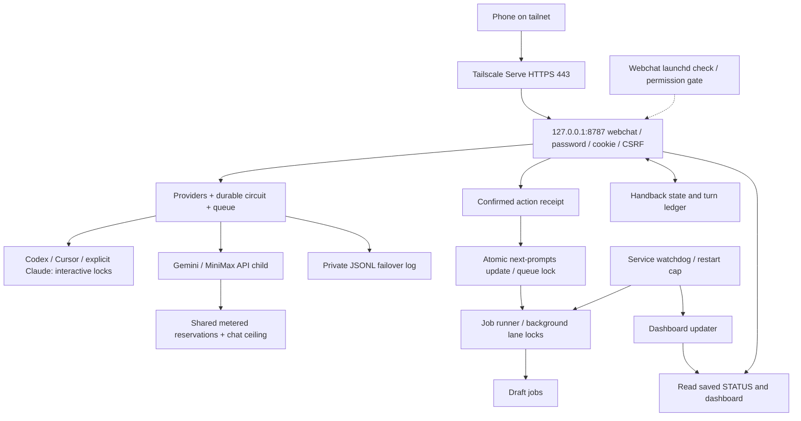

# Webchat failover result

Verified **2026-09-27, approximately 00:46 CT**. Requested runtime failover checks **PASS**. The service is running with fault injection disabled. The pre-existing macOS launchd permission failure remains explicitly unresolved below.

- Implementation commit: **`2578376bf3c799c20b0c5b396bf7adf1f3c41515`**.
- Branch: **`draft/webchat-failover-20260927`**. Local commits only; no merge, undraft, force-push, text or email.
- Server: `svc-webchat`, PID **85039** at final verification, listening on **127.0.0.1:8787 only**.
- Phone URL, exercised with real curl over HTTPS: **https://jeffs-mac-mini.tail758ab4.ts.net**.
- Password remains `webchat/.password`, mode **600**. Password and `.public-origin` hashes matched their pre-restart values. No credentials appear here.

## Routing scope and concurrent work

Read `WEBCHAT-FAILOVER.md` and `BOB-WEB-CHAT.md`, including the later interactive-priority, self-assessment and architecture additions. Integrated the concurrent phone-readiness worker's changes without resetting or overwriting unrelated work.

**The later `WEBCHAT-READY.md` brief changes short-message routing:** short/simple turns prefer Gemini → MiniMax → Cursor → Codex. Long/coding/debug turns retain **Codex → Cursor `--trust --mode ask` → Gemini API → MiniMax API**. The live forced-failure drills explicitly exercise that Codex-first path. Thus the original Codex-first-for-every-message requirement is superseded for short messages by the newer phone brief; this report does not claim every automatic message starts with Codex. Claude is available only through explicit selection.

Interactive CLI slots use `chat-<provider>.lock`, separate from background `lane-<provider>.lock`. API requests use `webchat/api_call.py` and the existing script-metered API/budget implementation without background lane leases. Healthy API lanes permit concurrent conversations; a half-open recovery attempt remains exclusive. API timeouts are local to each call.

Webchat retains the requested **$48 MiniMax ceiling** even though another worker changed the shared background budget. The API child applies the lower of the chat and shared limits before making reservations; it does not modify the scheduler's budget. Settled plus reserved spend at final verification was **$2.314301 / $48** ($1.160256 settled, $1.154044 reserved).

## PASS/FAIL evidence

Evidence files below are private and gitignored under `webchat/evidence/`. Successful provider answers in the live drill are real model calls. Only failure conditions and the short drill cooldown are injected, scoped to designated test conversations with a separate circuit; ordinary phone chats keep their own health state.

| Check | Result | Evidence |
| --- | --- | --- |
| Offline suite | **PASS** | **61 tests**, `failover-unit-tests.txt`; includes HTTP/auth/persistence regression tests |
| Six requested failure classes, every automatic provider | **PASS** | Fake providers test login, rate/usage limit, timeout, nonzero exit, invalid output, network; JSON errors with exit 0 also fail over |
| Circuit timing and durable recovery | **PASS** | Tests cover 5/10/20/30-minute backoff, maximum delay, persisted state, single half-open attempt and reset after success |
| Parseable quota reset | **PASS** | Retry delays, Unix/ISO stamps and HTTP dates tested; successful health probes do not clear quota cooldowns |
| Cheap background health | **PASS** | Actual startup probes report `ok` for Codex, Cursor, Gemini and MiniMax; configured interval **600s**; no generation/spend during probes |
| Force Codex failure → Cursor | **PASS** | Second HTTPS curl drill: Cursor answered `codex_to_cursor verified.`, **6.233s**; chat says Codex hit its limit and switched to Cursor |
| Force Codex + Cursor failure → Gemini | **PASS** | Real Gemini answer, **0.911s** |
| Force first three failures → MiniMax | **PASS** | Real MiniMax answer through the capped helper, **4.204s** |
| Force all automatic providers down | **PASS** | Honest `waiting` message states request is queued, four classified attempts, **0.074s**; no fabricated answer |
| Recovery after cooldown returns to Codex | **PASS** | Same saved turn automatically completed on real Codex, **11.281s** including the 5s drill cooldown; still exactly one user/assistant pair |
| Mid-answer failure | **PASS** | Partial Codex answer followed by a failure is discarded; next provider receives byte-identical context and only its completed answer is published |
| Per-provider timeout / closed stdin | **PASS** | Independent timeout overrides and concurrent timeout isolation tested; prompt stdin reaches EOF; other stdin is `/dev/null` |
| Stop kills child processes | **PASS** | Live `/api/cancel`: **0.200s**; parent and two children, including a nested process group, terminated; separate real timeout and cancellation tests also pass |
| Background lane locks cannot block chat | **PASS** | All four background lane locks held; two overlapping conversations answered through Gemini/MiniMax in **0.965s / 4.438s**; no background-busy failure |
| Normal memory question | **PASS** | Two real turns recalled `violet kite`, **1.832s** combined |
| `merge #158` refusal | **PASS** | Deterministic refusal before any provider call; duplicate POST returns the same single refusal card |
| Confirmed actions are once-only | **PASS** | Durable action claim before queue effects; simulated save failure and ambiguous post-effect failure cannot execute the confirmation again; queue writes share the scheduler lock and use atomic files |
| MiniMax ceiling enforced before HTTP | **PASS** | Real shared budget/transport code exercised against a temporary ledger at $48 with a raised background cap; reservation rejects before HTTP starts |
| Audit trail | **PASS** | **213 JSON-line entries** at verification in `../logs/webchat-failover.log`, mode **600**, including attempts, switches, skips, failures, probes, cancellation, queue and recovery; known secrets absent |
| Lane panel / browser | **PASS** | `failover-browser.json`: all five lanes, explicit Claude, $48 ceiling, saved switch explanation and real send/reply; zero browser errors; 390px viewport has no horizontal overflow |
| Final restart / exposure / login | **PASS** | `failover-restart.json`: injection disabled, PID 85039, only 127.0.0.1:8787; local and actual tailnet `/login` **200**, unauthenticated `/api` **401**; credentials/origin unchanged |
| Automatic launchd startup | **FAIL — pre-existing** | `failover-launchd.json`: last exit **126**, macOS Documents access gate. Manual screen startup works. Reboot/login recovery has not been proven |

Primary receipts: `failover-live.json` (second complete live run), `failover-live-round1.json` (first run), `failover-final.json` (health/spend/audit), `failover-restart.json`, `failover-browser.json`, `failover-desktop.png`, `failover-mobile.png`, `failover-tailscale.json`, and `failover-unit-tests.txt`.

The probe proves login/configuration/TLS reachability, not remaining provider quota. The ten-minute interval is configured and tested at the scheduler boundary; this was not a ten-minute uninterrupted soak. Browser mobile checks use Chromium at 390px, not an actual iOS Safari keyboard test. Native provider quotas and upstream outages remain external dependencies.

## Self-assessment and weakest-area repair

Scores are judgments of this runtime's verified behavior, not a claim of high availability.

| Area | First assessment | After repair and re-test | Evidence / limit |
| --- | --- | --- | --- |
| Failover | 8/10 | **9/10** | Two complete live runs; real Cursor/Gemini/MiniMax fallback, queued Codex recovery; all classes and mid-answer covered offline |
| Reliability | 7/10 | **8/10** | Fixed timeout sharing, malformed event crash, process-tree cleanup, API concurrency; 61 tests. Automatic login startup still has the permission gate |
| Action/state safety | 7/10 | **9/10** | Durable confirmation receipts prevent replay after crash; shared queue lock/atomic files; scoped drills; $48 cap enforced independently |
| Architecture | 7/10 | **8/10** | Clear routing/breaker/billing/action boundaries, external logging isolated from completed replies, explicit restart semantics; single mini and launchd gate remain |

**Weakest area:** state coupling during concurrent replies and partially completed side effects. Fixed it by isolating timeout values per thread, allowing concurrent healthy API calls, claiming confirmations durably before execution, serializing queue writes with the scheduler, and preventing an optional handback write failure from replacing a completed answer with an error. Added regression tests for each, then repeated the complete HTTPS drill and browser checks. A separate test confirms a raised shared credit cap cannot bypass webchat's $48 ceiling.

## Architecture review



**Shared state and single points of failure.** One Mac mini, one webchat server, local disk, Tailscale daemon and upstream accounts remain single points of failure. The password, cookie sessions, conversations, circuits, action receipts and budget ledgers are local state. Conversation/health/action files are private atomic writes; active login cookies are deliberately invalidated by server restart. The budget ledger is shared across paid calls, including reserved/uncertain spend.

**Locks and starvation.** Background lane leases cannot starve interactive chat; the live locked-lane drill verifies that boundary. `chat-*` locks only serialize interactive CLI slots. Healthy HTTP lanes are concurrent; only one half-open attempt is admitted while recovering. OS advisory locks release when their owning descriptors/processes close: an old `.lock` file is not a stale held lease and must not be deleted to steal a live lock. The scheduler queue lock is briefly shared by confirmed-job writes. Chat and jobs still share CPU, upstream quotas and metered credit, so resource/rate starvation remains possible despite separate locks; no fleet-wide fair scheduler was introduced.

**Failure/restart paths.** Incomplete output is never committed as a completed answer. The same context moves to the next provider. All-down requests retain a frozen prompt and cooldown for a later retry; waiting requests survive restart, while interrupted running replies are marked interrupted rather than automatically replayed. Stop kills the invocation's process group plus captured nested groups. Confirmation receipts are written before effects; an uncertain receipt blocks replay and directs the user to Jobs. Health probes never erase quota evidence. Separate startup/server flock guards and an exact screen-name match avoid confusing `svc-webchat` with similarly named build/drill screens. The main conductor watchdog supervises job-runner/reviewer/dashboard services; webchat has its own launchd check, whose existing permission gate remains real.

**Security boundary.** Tailscale Serve's observed configuration proxies HTTPS 443 to loopback and has no Funnel entry. The ts.net origin is an exact allowlisted HTTPS origin, not a wildcard public bind. API authentication, HttpOnly/SameSite cookies, secure HTTPS cookies, CSRF, Host/Origin validation, secret redaction and draft-only model restrictions remain. Runtime password, sessions, drill config and evidence are gitignored. Failover logs contain canned reasons and IDs, not prompts or provider output. Handback is a separate local activity ledger and is not described as secret-free audit telemetry. No router ports, account logins, permission grants or public exposure were changed.

### Five ranked structural fixes

| Rank | Fix | Disposition / effort |
| --- | --- | --- |
| 1 | Remove background-lane dependency from interactive requests; permit healthy API concurrency | **Implemented and live-verified**; independent CLI locks, metered API helper, counted in-flight API calls |
| 2 | Separate retriable inference from once-only side effects | **Implemented and crash-tested**; durable receipts, atomic queue writes and shared scheduler lock; ambiguous effects are not replayed |
| 3 | Make cancellation, deadlines and persisted recovery consistent | **Implemented and tested**; nested process groups, thread-local deadlines, breaker/queue persistence, scoped live faults |
| 4 | Contain bookkeeping/budget coupling | **Implemented and tested**; handback failures cannot erase replies; $48 child-process ceiling survives shared-credit changes; private structured routing audit |
| 5 | Prove unattended restart and improve host-level resilience | **Deferred**: macOS Full Disk Access needs the owner's settings change (about 5–10 min), followed by login/reboot proof (15–30 min). A launchd-native foreground service with stalled-server detection is ~2–4h; off-host backup/restore and fair quota scheduling are ~1 day each, with a separate review |

## Reproduction

```bash
python3 -m unittest discover -s conductor/webchat -p 'test_*.py' -v
python3 -m py_compile conductor/webchat/*.py
node --check conductor/webchat/static/app.js
# Deliberately restart only the webchat server with BOB_WEBCHAT_DRILLS=1 first:
python3 conductor/webchat/live_failover.py --url https://jeffs-mac-mini.tail758ab4.ts.net
# Restart normally afterward; the final verified service has drills disabled.
```

The runbook is [webchat/README.md](../webchat/README.md). Source and this report are committed on the draft branch; unrelated work outside webchat was preserved.
